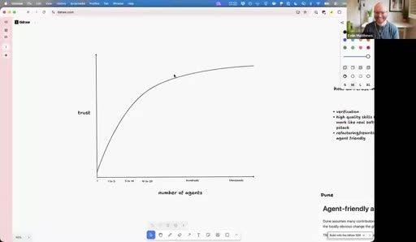

# 信任是使用 agent 的核心問題：不信任就只能微觀管理

講者說她用 agent 寫程式時最大的主題是「如何信任它」：當 agent 憑空猜測、第一百次信心滿滿地宣稱找到真正原因卻不是時，你就失去信任；信任不足就像不信任團隊的主管，只能微觀管理、無法平行化，也無法充分發揮 agent 的價值（講者主張）。

> 「how do you trust it?」
>
> — [[Hux - 今晚別刷Netflix了。  去看這個SpaceX AI工程師1小時的課程。  這是我見過最清晰、端到端講透GrokBot到底該怎麼真正用...#主題 2：核心問題：如何信任 agent？信任曲線（01:25–04:18）|01:34]]

> [!quote]- 前後文（中譯）（01:04–02:03）
> - [01:04] 我也試過很多人說的做法：不要直接叫 AI 把功能做出來，而是先請它寫規格（spec），你審查規格，再進行整件事。
> - [01:19] 好，我想你們看得到我的畫面吧？（主持人：看得到，沒問題。）
> - [01:25] 今天對我來說最大的主題是：我一直在用 agent 寫程式，我相信你們很多人也有一樣的經驗——你要如何信任它？
> - [01:36] 尤其如果你是寫了很多年程式的工程師，你對好的工程有很多看法與累積的教訓；當你看到 agent 在亂猜、產生幻覺，第一百次信心滿滿地宣稱找到了「鐵證」（smoking gun）、其實根本不是真正的問題時，你就失去很多信任。
> - [02:03] 而當你不太信任你的 agent，我覺得你就沒辦法充分發揮它們的價值。

**標示：** 講者主張，未查證

## 出處

- [[Hux - 今晚別刷Netflix了。  去看這個SpaceX AI工程師1小時的課程。  這是我見過最清晰、端到端講透GrokBot到底該怎麼真正用...#主題 2：核心問題：如何信任 agent？信任曲線（01:25–04:18）|Hux - 今晚別刷Netflix了。  去看這個SpaceX AI工程師1小時的課程。  這是我見過最清晰、端到端講透GrokBot到底該怎麼真正用...]]（01:34）
