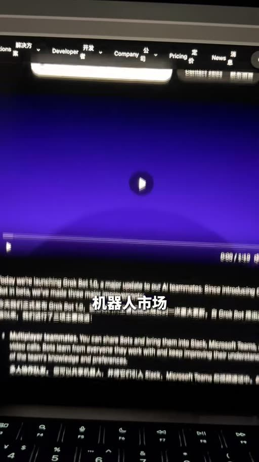

# 優勢三：Bot 市場——公司要僱人直接到市場找

講者說 Grok Bot 正在做機器人市場，以後公司要僱人直接到 Bot 市場找人就行；市場已對部分創作者有獎勵，未來可能進一步商業化，讓使用者直接付費給 Bot 製作人（講者主張，未查證）。

> 「直接到Bot市場找人就行了」
>
> — [[為什麼你要儘快用上Grok Bot#主題 4：優勢三：Bot 市場——公司要僱人直接到市場找 Bot（01:13–01:28）|01:18]]

> [!quote]- 前後文（00:57–01:30）
> - [00:57] 僱傭Grok Bot
> - [00:58] 把他當作同事交給他最艱難的任務前幾天馬斯克重用的華人女孩土豆女神也是這樣的理念一個人指揮50多個AI幹了20多個工程師的活這裡你可以直接把土豆女神這個做Bot的Bot加進來
> - [01:11] 讓他幫你設計更多的Bot同事
> - [01:13] 而這也是最牛的第三個優勢
> - [01:15] Grok Bot正在做一個機器人市場
> - [01:17] 以後公司要僱人
> - **[01:18] 直接到Bot市場找人就行了**
> - [01:20] 那現在這個市場已經在對一些創作者有一些獎勵
> - [01:23] 未來可能會進一步的商業化
> - [01:25] 慢慢的就可以讓使用者直接付費給Bot製作人
> - [01:28] 他跟Skill的最大區別是
> - [01:30] 他可以更加的客製化

**標示：** 講者主張，未查證

## 出處

- [[為什麼你要儘快用上Grok Bot#主題 4：優勢三：Bot 市場——公司要僱人直接到市場找 Bot（01:13–01:28）|為什麼你要儘快用上Grok Bot]]（01:18）
