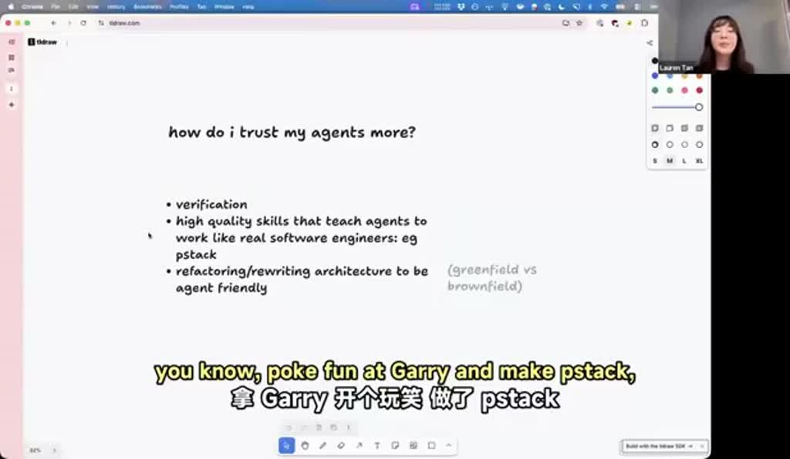

# 功能地圖：教 agent 如何走到應用的每個功能

講者說驗證 skill 裡有個「功能地圖」，教 agent 怎麼走到應用的所有功能（含 UI 路徑、快捷鍵、DOM 屬性），讓 agent 能把模糊的使用者回報甚至只有一張截圖的回報，對應到具體功能；PStack 的 create verification skill 會探索程式碼並建立初版功能地圖（講者所述）。

> 「it teaches the agent how to get」
>
> — [[Hux - 今晚別刷Netflix了。  去看這個SpaceX AI工程師1小時的課程。  這是我見過最清晰、端到端講透GrokBot到底該怎麼真正用...#主題 5：實例：Cursor agent 視窗、control glass skill 與功能地圖（07:02–13:46）|11:43]]

> [!quote]- 前後文（中譯）（11:38–11:38）
> - [11:38] 所以這個功能地圖非常有用：它教 agent 如何到達你所有的功能。在我做的 PStack 外掛裡（Google 搜尋「PStack cursor」就找得到）有一個 create verification skill，會幫你替自己建立這樣的東西，包含功能地圖：它會探索程式碼，建出初版功能地圖，告訴 agent 怎麼走到各種功能。

**標示：** 講者主張，未查證

## 出處

- [[Hux - 今晚別刷Netflix了。  去看這個SpaceX AI工程師1小時的課程。  這是我見過最清晰、端到端講透GrokBot到底該怎麼真正用...#主題 5：實例：Cursor agent 視窗、control glass skill 與功能地圖（07:02–13:46）|Hux - 今晚別刷Netflix了。  去看這個SpaceX AI工程師1小時的課程。  這是我見過最清晰、端到端講透GrokBot到底該怎麼真正用...]]（11:43）
