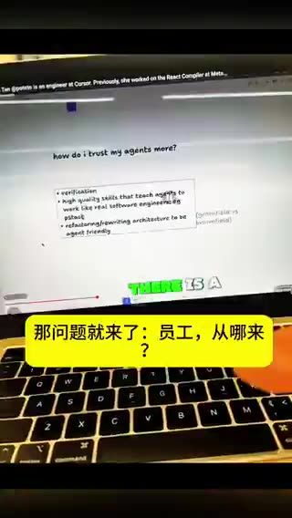

# 把 AI 當員工，它才開始動腦子

講者轉述 Lauren Tan 的核心觀念：把 AI 當工具，等於僱了個博士回來抄快遞單，抄一萬遍也只是個抄單的；把 AI 當員工，它才開始動腦子，並總結「把 AI 當工具，AI 就給你幹活；把 AI 當員工，AI 就給你幹事業」（講者轉述，未查證）。

> 「你把 AI 當員工他才開始動腦子」
>
> — [[永動之初 - 這個講的太好了 一個不會寫程式碼的女生，憑什麼當上馬斯克AI團隊負責人？#主題 2：核心觀念：把 AI 當員工，不當工具（00:25–00:52）|00:49]]

> [!quote]- 前後文（00:39–00:59）
> - [00:39] 就是下指令啥的結果看完發現
> - [00:41] 我認知的出發點都大錯特錯了呀
> - [00:44] 她說
> - [00:44] 你把 AI 當工具
> - [00:46] 等於僱了個博士回來抄快遞單
> - [00:47] 抄一萬遍他也就是個抄單的
> - **[00:49] 你把 AI 當員工他才開始動腦子**
> - [00:52] 那問題就來了員工從哪來
> - [00:54] 她頭一個乾的事就是個野路子讓
> - [00:56] AI 造 AI
> - [00:57] 它造出來的第一個 AI 不是幹活的
> - [00:59] 而是造 AI 的 AI 設計師

**標示：** 講者主張，未查證

## 出處

- [[永動之初 - 這個講的太好了 一個不會寫程式碼的女生，憑什麼當上馬斯克AI團隊負責人？#主題 2：核心觀念：把 AI 當員工，不當工具（00:25–00:52）|永動之初 - 這個講的太好了 一個不會寫程式碼的女生，憑什麼當上馬斯克AI團隊負責人？]]（00:49）
