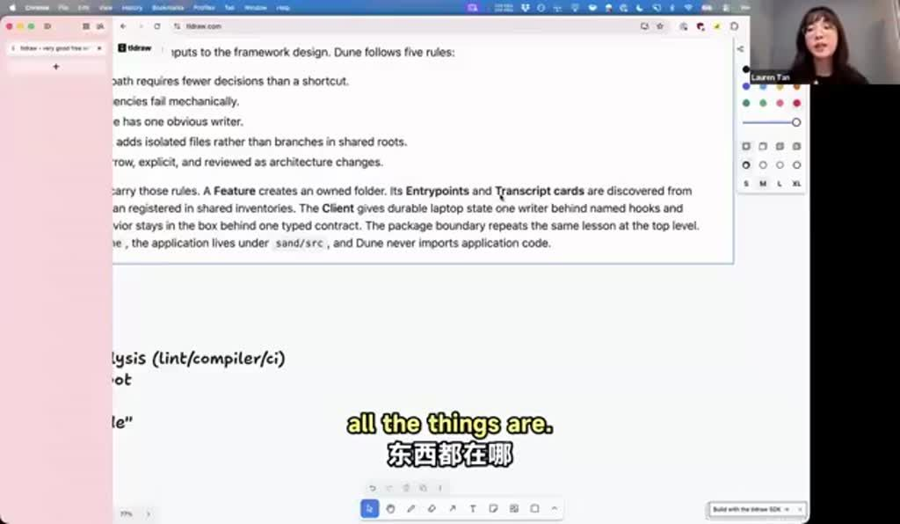

# 最短路徑就是最好路徑：讓捷徑成為正解

講者說 Dune 框架的一個關鍵原則是「最短的路徑就是最好的路徑」：agent 愛走捷徑、找最快的方式解題，所以就讓最快的方式也是最好的方式；為此她把每個 feature 的程式碼共置在單一目錄、讓開發方式高度慣例化，連最笨的 agent 也能做對（講者主張）。

> 「the shortest path is the best path」
>
> — [[Hux - 今晚別刷Netflix了。  去看這個SpaceX AI工程師1小時的課程。  這是我見過最清晰、端到端講透GrokBot到底該怎麼真正用...#主題 13：多層約束：硬強制優先，軟規則輔助（42:42–48:25）|44:28]]

> [!quote]- 前後文（中譯）（44:14–44:46）
> - [44:14] 它是為「最笨的 agent」而設計，你不必思考。這個框架有個關鍵原則：「最短的路徑就是最好的路徑」，因為這正好契合 agent 愛寫程式的方式——它們愛走捷徑、找最快的方式解決問題，那為何不讓它成為最好的解法呢？
> - [44:46] 我大概不會講所有細節，這個框架更像是一組想法與原則的集合，而不是會開源的東西；你可以把這張截圖下來、叫你的 agent 也替你做出類似的東西。

**標示：** 講者主張，未查證

## 出處

- [[Hux - 今晚別刷Netflix了。  去看這個SpaceX AI工程師1小時的課程。  這是我見過最清晰、端到端講透GrokBot到底該怎麼真正用...#主題 13：多層約束：硬強制優先，軟規則輔助（42:42–48:25）|Hux - 今晚別刷Netflix了。  去看這個SpaceX AI工程師1小時的課程。  這是我見過最清晰、端到端講透GrokBot到底該怎麼真正用...]]（44:28）
