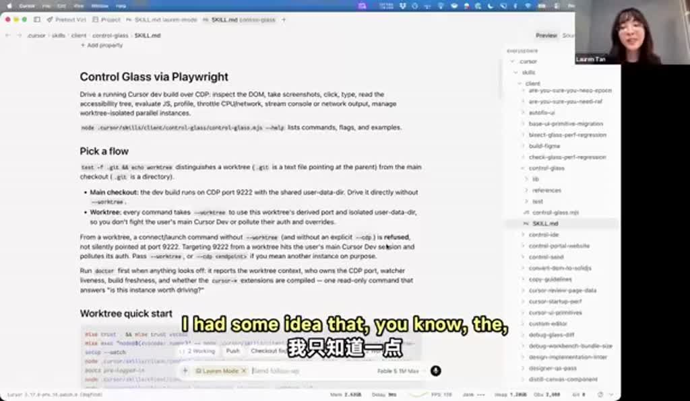

# 沒有驗證 skill 時，你自己就是瓶頸

講者說用 agent 開發卻沒有驗證 skill 時，你自己就是驗證者、就是瓶頸：你要打開本機 build 看結果、複製截圖與錯誤給 agent，無法平行化；所以她替 Cursor 做的第一批 skill 之一就是讓 agent 能自己操作並驗證應用（講者主張）。

> 「you are the verifier」
>
> — [[Hux - 今晚別刷Netflix了。  去看這個SpaceX AI工程師1小時的課程。  這是我見過最清晰、端到端講透GrokBot到底該怎麼真正用...#主題 5：實例：Cursor agent 視窗、control glass skill 與功能地圖（07:02–13:46）|09:02]]

> [!quote]- 前後文（中譯）（08:54–08:54）
> - [08:54] 如果你做過效能調校，或是用 agent 開發卻沒有「驗證 skill」，那你自己就是那個驗證者、就是瓶頸：你叫 agent 去做事，它寫了一些程式碼，你打開本機的 dev build，說「不能動」，再把截圖或 console 錯誤複製貼上，agent 慢慢處理、試著理解、修好，但你始終在迴圈裡當瓶頸，所以根本無法平行化。

**標示：** 講者主張，未查證

## 出處

- [[Hux - 今晚別刷Netflix了。  去看這個SpaceX AI工程師1小時的課程。  這是我見過最清晰、端到端講透GrokBot到底該怎麼真正用...#主題 5：實例：Cursor agent 視窗、control glass skill 與功能地圖（07:02–13:46）|Hux - 今晚別刷Netflix了。  去看這個SpaceX AI工程師1小時的課程。  這是我見過最清晰、端到端講透GrokBot到底該怎麼真正用...]]（09:02）
