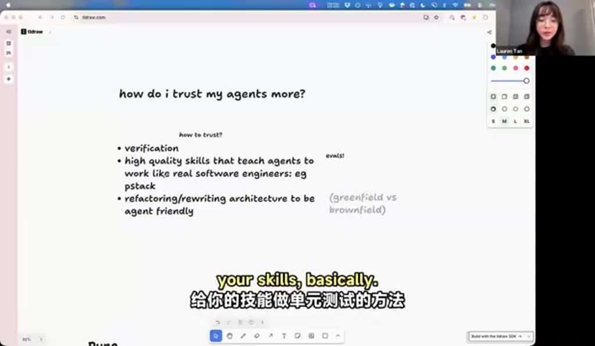

# 評估時別讓子 agent 知道自己在被評估

講者說做 eval 時她為子 agent 建立的目錄名稱經過巧妙設計，不讓子 agent 知道自己正被評估，因為 agent 其實看得出來，一旦看出來就會改變行為，使評估失真（講者主張，未查證）。

> 「let the sub-agent know that it's being evaluated」
>
> — [[Hux - 今晚別刷Netflix了。  去看這個SpaceX AI工程師1小時的課程。  這是我見過最清晰、端到端講透GrokBot到底該怎麼真正用...#主題 7：如何維護 skill：把 eval 當作 agent 的單元測試（17:26–21:36）|19:40]]

> [!quote]- 前後文（中譯）（19:49–19:49）
> - [19:49] 總之就是用來測試我正在製作或修改的 skill 是否真的做到我以為它做到的事。Cursor 一個很好的地方是我們支援很多不同的模型，所以你可以跨各種模型去 eval 你的 skill，並了解它在不同矩陣上的表現，尤其是你常用的模型。

**標示：** 講者主張，未查證

## 出處

- [[Hux - 今晚別刷Netflix了。  去看這個SpaceX AI工程師1小時的課程。  這是我見過最清晰、端到端講透GrokBot到底該怎麼真正用...#主題 7：如何維護 skill：把 eval 當作 agent 的單元測試（17:26–21:36）|Hux - 今晚別刷Netflix了。  去看這個SpaceX AI工程師1小時的課程。  這是我見過最清晰、端到端講透GrokBot到底該怎麼真正用...]]（19:40）
