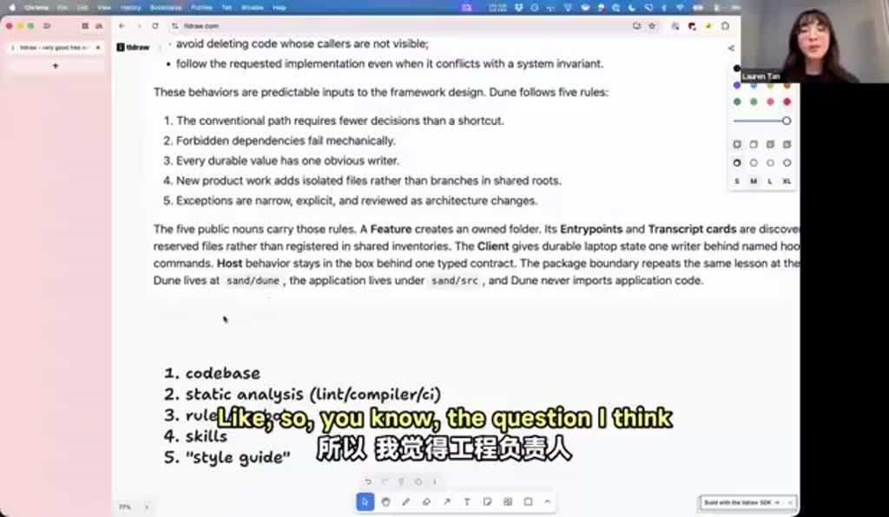

# 靠人在審查時糾正，就該把它變成硬規則

講者說如果你的程式碼庫靠真人在 code review 時反覆糾正來維持不變量，是最糟的處境，每次都該視為 code smell，問自己：與其在 PR 留言，怎麼把它變成硬規則、lint 規則、CI 失敗，甚至從根本消除這個問題？她強調硬性強制（CI、靜態分析、編譯器）優先，BugBot 規則與 skill 只是較軟的輔助層（講者主張）。

> 「how do I turn this into a hard rule」
>
> — [[Hux - 今晚別刷Netflix了。  去看這個SpaceX AI工程師1小時的課程。  這是我見過最清晰、端到端講透GrokBot到底該怎麼真正用...#主題 13：多層約束：硬強制優先，軟規則輔助（42:42–48:25）|47:46]]

> [!quote]- 前後文（中譯）（47:20–48:00）
> - [47:20] 最糟的處境，是卡在「程式碼審查地獄」：你靠真人讀程式碼、說「你應該這樣做」來強制維持程式碼庫的各種不變量。每次你需要這樣做，都該視為一種 code smell（反模式），並問自己：與其在 PR 上留言，我怎麼把它變成硬規則？怎麼變成 lint 規則？怎麼變成 CI 失敗？甚至怎麼從根本上整個消除這個問題？
> - [48:00] 我還可以談另一個我做過的遷移，不過我先暫停。（主持人：我覺得我正是你描述的這種狀況——我沒有這些規則，所以這場之後有事要做：我現在大概是本機兩三個平行 agent 的階段，我相信多數人也一樣。）

**標示：** 講者主張，未查證

## 出處

- [[Hux - 今晚別刷Netflix了。  去看這個SpaceX AI工程師1小時的課程。  這是我見過最清晰、端到端講透GrokBot到底該怎麼真正用...#主題 13：多層約束：硬強制優先，軟規則輔助（42:42–48:25）|Hux - 今晚別刷Netflix了。  去看這個SpaceX AI工程師1小時的課程。  這是我見過最清晰、端到端講透GrokBot到底該怎麼真正用...]]（47:46）
