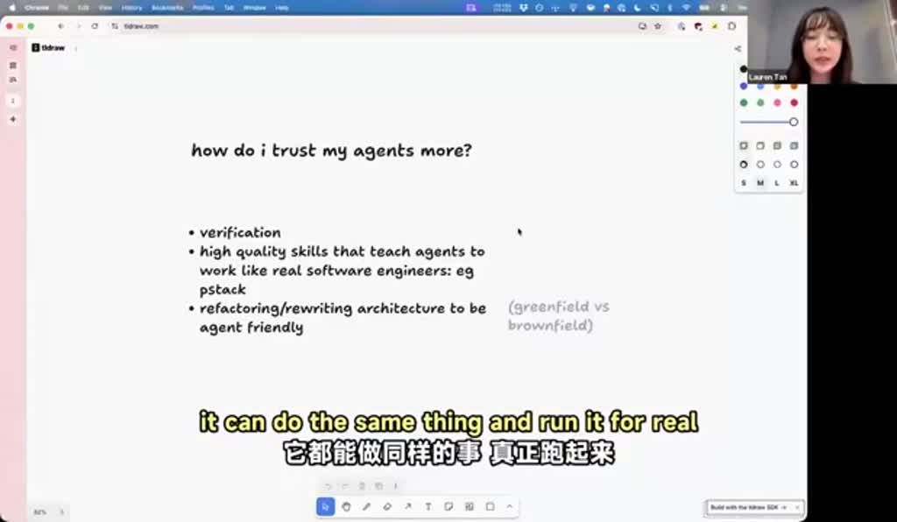

# 驗證不保證程式碼好，但能保證「正確」

講者說與 agent 合作最重要的技能是驗證：讓 agent 能真的執行程式碼、取得 CPU 追蹤、heap snapshot、開模擬器，實際測試並驗證自己的工作；它不保證 agent 寫出好的程式碼，但能讓它至少寫出「正確」的程式碼，是信任 agent 的一大步（講者主張）。

> 「it doesn't guarantee your agent writes good code」
>
> — [[Hux - 今晚別刷Netflix了。  去看這個SpaceX AI工程師1小時的課程。  這是我見過最清晰、端到端講透GrokBot到底該怎麼真正用...#主題 4：最重要的技能：驗證（verification）（06:03–07:02）|06:48]]

> [!quote]- 前後文（中譯）（06:18–07:02）
> - [06:18] 我說的驗證，是指 agent 能真的執行程式碼、取得 CPU 追蹤或 heap snapshot、開 iOS 模擬器——不管你的應用程式以什麼方式呈現給使用者，它都能做同樣的事、真正跑起來，實際測試並驗證自己的工作。
> - [06:45] 因為這才是真正「閉環」的東西：它不保證 agent 寫出好的程式碼，但能讓它至少寫出「正確」的程式碼，這對於能夠信任 agent 是非常大的一步。
> - [07:02] 我可以分享一個我們在 Cursor 內部的例子：Cursor 的 agent 視窗（agent window）。

**標示：** 講者主張，未查證

## 出處

- [[Hux - 今晚別刷Netflix了。  去看這個SpaceX AI工程師1小時的課程。  這是我見過最清晰、端到端講透GrokBot到底該怎麼真正用...#主題 4：最重要的技能：驗證（verification）（06:03–07:02）|Hux - 今晚別刷Netflix了。  去看這個SpaceX AI工程師1小時的課程。  這是我見過最清晰、端到端講透GrokBot到底該怎麼真正用...]]（06:48）
