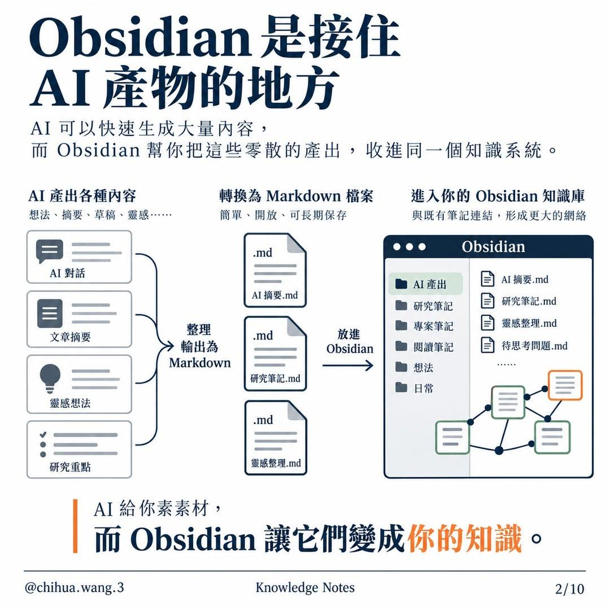

# Markdown 檔適合接住 AI 產物

把 AI 的對話、摘要、靈感整理成 .md，再放進 Obsidian 與既有筆記連結。

> 「轉換為 Markdown 檔案（簡單、開放、可長期保存）」
>
> — [[AI 時代為什麼 Obsidian 反而更重要？#第 2 頁：Obsidian 是接住 AI 產物的地方|第 2 頁]]

> [!quote]- 前後文（第 2 頁）
> - [00:02] Obsidian 是接住 AI 產物的地方
> - [00:02] AI 可以快速生成大量內容，而 Obsidian 幫你把這些零散的產出，收進同一個知識系統。
> - [00:02] AI 產出各種內容（想法、摘要、草稿、靈感……）：AI 對話、文章摘要、靈感想法、研究重點。
> - **[00:02] 轉換為 Markdown 檔案（簡單、開放、可長期保存）：AI 摘要.md、研究筆記.md、靈感整理.md。**
> - [00:02] 進入你的 Obsidian 知識庫（與既有筆記連結，形成更大的網絡）：資料夾 AI 產出、研究筆記、專案筆記、閱讀筆記、想法、日常；檔案 AI 摘要.md、研究筆記.md、靈感整理.md、待思考問題.md。
> - [00:02] 結語：AI 給你素材，而 Obsidian 讓它們變成你的知識。（圖上寫成「素素材」，疑為筆誤）

**標示：** 講者／作者主張，未查證

## 出處

- [[AI 時代為什麼 Obsidian 反而更重要？#第 2 頁：Obsidian 是接住 AI 產物的地方|AI 時代為什麼 Obsidian 反而更重要？]]（第 2 頁）
