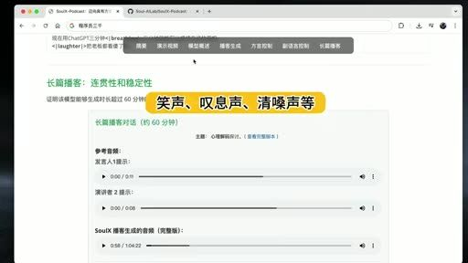

# 多人多輪長音訊要保持每個人聲音一致

講者說像播客式多輪多人對話的長音訊，這個模型能穩定保持每個人聲音的一致性與連貫性，音色、情緒、節奏全部穩定；他並稱能一口氣穩定輸出超過 90 分鐘的音訊（講者主張，未查證）。

> 「也能穩定保持每個人聲音的一致性和連貫性」
>
> — [[Github一開源，就登頂？一口氣合成90分鐘音訊～#主題 5：示範三：一口氣穩定輸出超過 90 分鐘的播客（01:40–02:25）|01:46]]

> [!quote]- 前後文（01:32–01:57）
> - [01:32] 現在連我媽都用AI寫廣場舞文案了
> - [01:36] 這個例子很生動
> - [01:38] 是的
> - [01:38] 特別是生成式AI
> - [01:40] 一口氣穩定輸出超90分鐘播客
> - [01:43] 像這種播客式多輪多人對話的長音訊
> - **[01:46] 也能穩定保持每個人聲音的一致性和連貫性**
> - [01:49] 音色 情緒 節奏全部穩得離譜
> - [01:52] 各位親愛的聽眾朋友們大家好
> - [01:54] 歡迎收聽本期的心理節目
> - [01:56] 我是簡安
> - [01:57] 大家好 我是陸陽

**標示：** 講者主張，未查證

## 出處

- [[Github一開源，就登頂？一口氣合成90分鐘音訊～#主題 5：示範三：一口氣穩定輸出超過 90 分鐘的播客（01:40–02:25）|Github一開源，就登頂？一口氣合成90分鐘音訊～]]（01:46）
