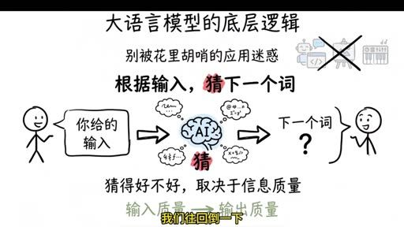

# Agent 能否靠譜，關鍵不在模型多強，而在模型外的工程架構

講者說一個 AI Agent 最終能不能靠譜地跑起來、穩定完成任務，關鍵往往不在模型有多強，而在模型外面那一整套工程架構做得怎麼樣；這也是他認為 Harness Engineering 不同於曇花一現的流行詞之處（講者主張）。

> 「關鍵往往不在模型有多強」
>
> — [[什麼是Harness#主題 1：開場：什麼是 Harness Engineering（00:00–00:50）|00:44]]

> [!quote]- 前後文（00:32–00:55）
> - [00:32] 大家早就習慣了
> - [00:33] 不過Harness Engineering
> - [00:34] 跟那些曇花一現的流行詞不太一樣
> - [00:37] 它戳中了一個越來越沒法迴避的事實
> - [00:39] 一個AI Agent最終能不能靠譜的跑起來
> - [00:43] 穩定的完成任務
> - **[00:44] 關鍵往往不在模型有多強**
> - [00:46] 而在模型外面那一整套工程架構做的怎麼樣
> - [00:50] 我們往回倒一下
> - [00:51] 大語言模型這個東西
> - [00:53] 你別被它花裡胡哨的應用迷惑了
> - [00:55] 它的底層邏輯其實特別簡單

**標示：** 講者主張，未查證

## 出處

- [[什麼是Harness#主題 1：開場：什麼是 Harness Engineering（00:00–00:50）|什麼是Harness]]（00:44）
