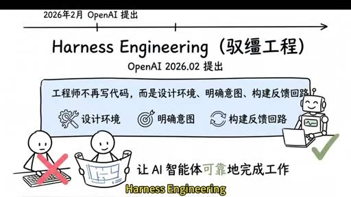

# Harness Engineering：工程師設計環境與反饋迴路，而不是寫程式碼

講者說 Harness Engineering 是 OpenAI 在 2026 年 2 月提出的工程範式（起源為講者主張，未查證）：工程師不再寫程式碼，而是設計環境、明確意圖、構建反饋迴路，讓 AI 智慧體可靠地完成工作。

> 「工程師不再寫程式碼，而是設計環境」
>
> — [[什麼是Harness#主題 1：開場：什麼是 Harness Engineering（00:00–00:50）|00:15]]

> [!quote]- 前後文（00:00–00:43）
> - [00:00] 什麼是Harness Engineering?理解了它，你就理解了AI Agent的底層工作原理。
> - [00:06] 才短短幾天，這個詞就刷遍了各種AI社群、技術部落格和開發者討論區，很多人會把它和Hermes Agent（愛馬仕）搞混。
> - **[00:15] Harness Engineering是OpenAI在2026年2月提出的工程範式，工程師不再寫程式碼，而是設計環境，明確意圖，構建反饋迴路，讓AI智慧體可靠地完成工作。**
> - [00:27] 在AI這個圈子裡
> - [00:28] 隔三差五就蹦出來一個新名詞
> - [00:30] 新範式新工具
> - [00:32] 大家早就習慣了
> - [00:33] 不過Harness Engineering
> - [00:34] 跟那些曇花一現的流行詞不太一樣
> - [00:37] 它戳中了一個越來越沒法迴避的事實
> - [00:39] 一個AI Agent最終能不能靠譜的跑起來
> - [00:43] 穩定的完成任務

**標示：** 講者主張，未查證

## 出處

- [[什麼是Harness#主題 1：開場：什麼是 Harness Engineering（00:00–00:50）|什麼是Harness]]（00:15）
