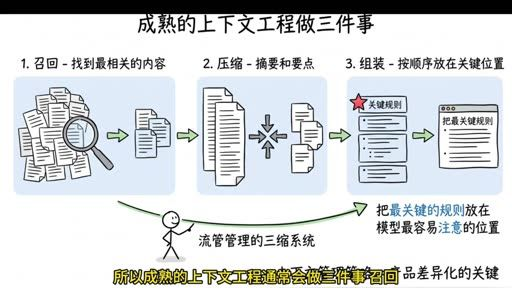

# 成熟上下文工程的三件事：召回、壓縮、組裝

講者說成熟的上下文工程通常做三件事：召回（從大量資訊中找出與當前任務最相關的內容）、壓縮（把過長的檔案、摘要或歷史對話壓縮成要點）、組裝（按特定順序放進上下文，把最關鍵的規則放在模型最容易注意的位置）。

> 「召回壓縮組裝」
>
> — [[什麼是Harness#主題 3：第二層演進：Context engineering（資訊供給）（01:24–02:29）|01:54]]

> [!quote]- 前後文（01:41–02:21）
> - [01:41] 但直接決定模型答的好不好
> - [01:44] 於是context engineering來了
> - [01:46] 上下文工程
> - [01:47] 核心不是資訊越多越好
> - [01:49] 而是在正確的時間給正確的資訊
> - [01:51] 因為模型的上下文視窗有限
> - **[01:54] 塞太多他會失憶前面定好的規矩後面就忘了所以成熟的上下文工程通常會做三件事召回壓縮組裝先從大量資訊裡召回與當前任務最相關的內容**
> - [02:06] 再把過長的檔案摘要或歷史對話壓縮成要點和關鍵資訊
> - [02:10] 最後按照特定順序組裝進上下文裡
> - [02:13] 把最關鍵的規則和指令放在模型最容易注意的位置
> - [02:17] 這也是為什麼兩個產品即使底層呼叫的是同一個模型
> - [02:21] 只要上下文管理策略不同

**標示：** 講者主張，未查證

## 出處

- [[什麼是Harness#主題 3：第二層演進：Context engineering（資訊供給）（01:24–02:29）|什麼是Harness]]（01:54）
