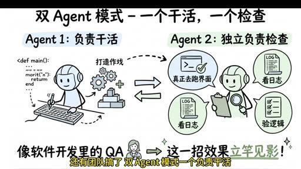

# 雙 Agent 模式：一個幹活，一個獨立檢查

講者轉述有團隊用雙 Agent 模式：一個負責幹活、一個獨立負責檢查，像軟體開發裡的 QA，真正去跑介面、看日誌、驗邏輯，他說效果立竿見影；另有團隊沒換模型、只重新設計任務拆解、狀態管理、結果校驗與反饋閉環，任務成功率從 60% 幾拉到 90% 幾（講者轉述，未查證）。

> 「一個負責幹活」
>
> — [[什麼是Harness#主題 13：實例：重構執行骨架與雙 Agent 模式（07:02–07:32）|07:23]]

> [!quote]- 前後文（07:12–07:29）
> - [07:12] 就是把任務拆解
> - [07:14] 狀態管理
> - [07:15] 結果校驗和反饋閉環
> - [07:16] 重新設計了一遍
> - [07:17] agent的任務成功率直接從60%幾拉到90%幾
> - [07:21] 還有團隊搞了雙agent模式
> - **[07:23] 一個負責幹活**
> - [07:24] 一個獨立負責檢查
> - [07:25] 像軟體開發裡的QA一樣
> - [07:27] 真正去跑介面
> - [07:29] 看日誌
> - [07:29] 驗邏輯

**標示：** 講者主張，未查證

## 出處

- [[什麼是Harness#主題 13：實例：重構執行骨架與雙 Agent 模式（07:02–07:32）|什麼是Harness]]（07:23）
