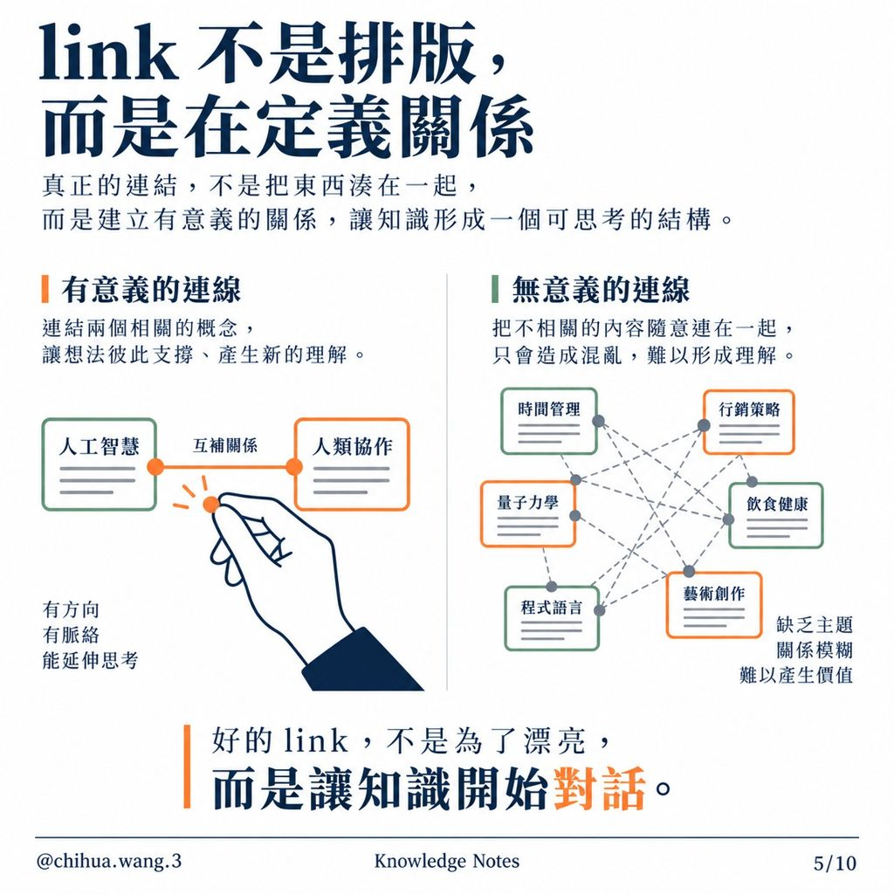

# link 是在定義關係，不是排版

第 5 頁主張 link 不是排版，而是在定義關係。有意義的連線連結兩個相關概念（例：人工智慧與人類協作是互補關係），有方向、有脈絡、能延伸思考；把時間管理、量子力學、飲食健康等不相關的內容隨意互連，只會缺乏主題、關係模糊，難以產生價值。

> 「好的 link，不是為了漂亮，而是讓知識開始對話。」
>
> — [[AI 時代為什麼 Obsidian 反而更重要？#第 5 頁：link 不是排版，而是在定義關係|第 5 頁]]

> [!quote]- 前後文（第 5 頁）
> - [00:05] link 不是排版，而是在定義關係
> - [00:05] 真正的連結，不是把東西湊在一起，而是建立有意義的關係，讓知識形成一個可思考的結構。
> - [00:05] 有意義的連線：連結兩個相關的概念，讓想法彼此支撐、產生新的理解。例：人工智慧 —互補關係— 人類協作；有方向、有脈絡、能延伸思考。
> - [00:05] 無意義的連線：把不相關的內容隨意連在一起，只會造成混亂，難以形成理解。例：時間管理、行銷策略、量子力學、飲食健康、程式語言、藝術創作彼此亂連；缺乏主題、關係模糊、難以產生價值。
> - **[00:05] 結語：好的 link，不是為了漂亮，而是讓知識開始對話。**

**標示：** 講者／作者主張，未查證

## 出處

- [[AI 時代為什麼 Obsidian 反而更重要？#第 5 頁：link 不是排版，而是在定義關係|AI 時代為什麼 Obsidian 反而更重要？]]（第 5 頁）
