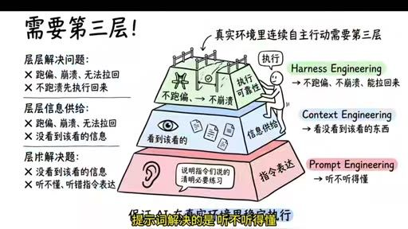

# 三層分工：提示詞管聽懂、上下文管看到、Harness 管跑得穩

講者歸納三層：提示詞解決聽不聽得懂，上下文解決看沒看到該看的東西，當 AI 要在真實環境連續自主行動時，還需要第三層保證它不跑偏、不崩潰、出錯能拉回來，這就是 Harness Engineering 要做的事；三者是層層巢狀（Prompt 是 Context 的一部分、Context 又是 Harness 的一部分），不是替代關係。

> 「提示詞解決的是聽不聽得懂」
>
> — [[什麼是Harness#主題 4：為什麼需要第三層：長任務會跑偏（02:29–03:15）|02:59]]

> [!quote]- 前後文（02:50–03:09）
> - [02:50] 他規劃了步驟
> - [02:51] 但中間突然跳過關鍵環節
> - [02:53] 他在長任務裡越跑越偏
> - [02:55] 開始反覆試錯
> - [02:56] 無限迴圈
> - [02:57] 甚至一本正經的胡說八道
> - **[02:59] 提示詞解決的是聽不聽得懂**
> - [03:02] 上下文解決的是
> - [03:03] 看沒看到該看的東西
> - [03:05] 但當AI要在真實環境裡
> - [03:07] 連續自主行動的時候
> - [03:09] 你還需要第三層

**標示：** 講者主張，未查證

## 出處

- [[什麼是Harness#主題 4：為什麼需要第三層：長任務會跑偏（02:29–03:15）|什麼是Harness]]（02:59）
