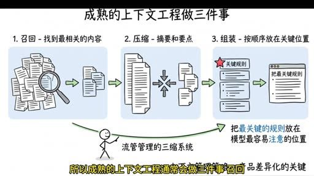

# 上下文工程：在正確的時間給正確的資訊

講者說上下文工程的核心不是資訊越多越好，而是在正確的時間給正確的資訊，因為上下文視窗有限，塞太多模型會失憶、前面定好的規矩後面就忘。他並稱兩個產品即使底層呼叫同一個模型，上下文管理策略不同效果也可能天差地別（講者主張）。

> 「而是在正確的時間給正確的資訊」
>
> — [[什麼是Harness#主題 3：第二層演進：Context engineering（資訊供給）（01:24–02:29）|01:49]]

> [!quote]- 前後文（01:38–02:13）
> - [01:38] 退貨政策是什麼吧
> - [01:39] 這些資訊不是提示詞
> - [01:41] 但直接決定模型答的好不好
> - [01:44] 於是context engineering來了
> - [01:46] 上下文工程
> - [01:47] 核心不是資訊越多越好
> - **[01:49] 而是在正確的時間給正確的資訊**
> - [01:51] 因為模型的上下文視窗有限
> - [01:54] 塞太多他會失憶前面定好的規矩後面就忘了所以成熟的上下文工程通常會做三件事召回壓縮組裝先從大量資訊裡召回與當前任務最相關的內容
> - [02:06] 再把過長的檔案摘要或歷史對話壓縮成要點和關鍵資訊
> - [02:10] 最後按照特定順序組裝進上下文裡
> - [02:13] 把最關鍵的規則和指令放在模型最容易注意的位置

**標示：** 講者主張，未查證

## 出處

- [[什麼是Harness#主題 3：第二層演進：Context engineering（資訊供給）（01:24–02:29）|什麼是Harness]]（01:49）
