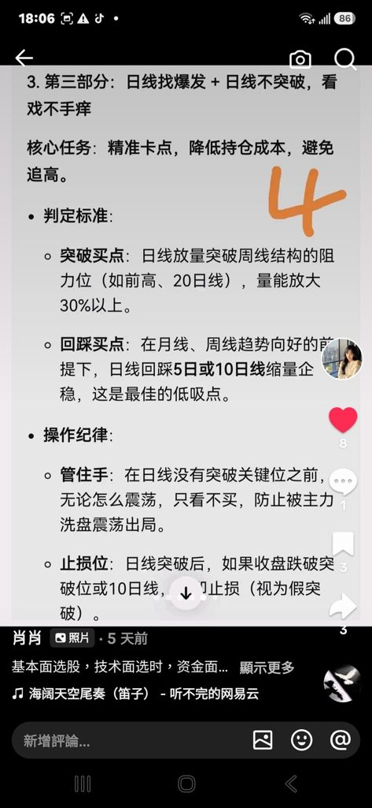

# 日線兩種買點：放量突破阻力位，或回踩 5／10 日線縮量企穩

貼文的突破買點是日線放量突破週線結構阻力位（量能放大 30% 以上），回踩買點是在月週線向好前提下回踩 5 或 10 日線縮量企穩；日線突破後收盤跌破突破位或 10 日線就止損，視為假突破。數字門檻為作者主張，未查證。

> 「日線回踩5日或10日線縮量企穩，這是最佳的低吸點」
>
> — [[三級K線操盤口訣：月線定生死、周線看結構、日線找爆發#第 4 頁：第三部分：日線找爆發、不突破看戲不手癢|第 4 頁]]

> [!quote]- 前後文（第 4 頁）
> - [00:04] 3. 第三部分：日線找爆發 + 日線不突破，看戲不手癢
> - [00:04] 核心任務：精準卡點，降低持倉成本，避免追高。
> - [00:04] • 判定標準：
> - [00:04] ○ 突破買點：日線放量突破週線結構的阻力位（如前高、20日線），量能放大30%以上。
> - **[00:04] ○ 回踩買點：在月線、週線趨勢向好的前提下，日線回踩5日或10日線縮量企穩，這是最佳的低吸點。**
> - [00:04] • 操作紀律：
> - [00:04] ○ 管住手：在日線沒有突破關鍵位之前，無論怎麼震盪，只看不買，防止被主力洗盤震盪出局。
> - [00:04] ○ 止損位：日線突破後，如果收盤跌破突破位或10日線，立即止損（視為假突破）。

**標示：** 作者主張，未查證

## 出處

- [[三級K線操盤口訣：月線定生死、周線看結構、日線找爆發#第 4 頁：第三部分：日線找爆發、不突破看戲不手癢|三級K線操盤口訣：月線定生死、周線看結構、日線找爆發]]（第 4 頁）
