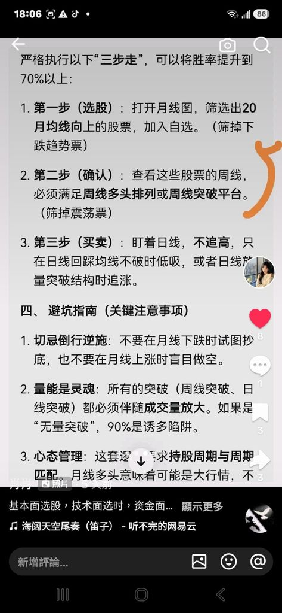

# 突破必須放量：無量突破多半是誘多陷阱

貼文把量能稱為靈魂，所有突破（週線突破、日線突破）都必須伴隨成交量放大，否則作者主張 90% 是誘多陷阱。90% 這個比例沒有出處，未查證。

> 「如果是“無量突破”，90%是誘多陷阱」
>
> — [[三級K線操盤口訣：月線定生死、周線看結構、日線找爆發#第 5 頁：三步走與避坑指南|第 5 頁]]

> [!quote]- 前後文（第 5 頁）
> - [00:05] （上文被截斷）嚴格執行以下“三步走”，可以將勝率提升到70%以上：
> - [00:05] 1. 第一步（選股）：打開月線圖，篩選出20月均線向上的股票，加入自選。（篩掉下跌趨勢票）
> - [00:05] 2. 第二步（確認）：查看這些股票的週線，必須滿足週線多頭排列或週線突破平台。（篩掉震盪票）
> - [00:05] 3. 第三步（買賣）：盯著日線，不追高，只在日線回踩均線不破時低吸，或者日線放量突破結構時追漲。
> - [00:05] 四、避坑指南（關鍵注意事項）
> - [00:05] 1. 切忌倒行逆施：不要在月線下跌時試圖抄底，也不要在月線上漲時盲目做空。
> - **[00:05] 2. 量能是靈魂：所有的突破（週線突破、日線突破）都必須伴隨成交量放大。如果是“無量突破”，90%是誘多陷阱。**
> - [00:05] 3. 心態管理：這套邏輯要求持股週期與週期匹配。月線多頭意味著可能是大行情，不（下文被截斷）

**標示：** 作者主張，未查證

## 出處

- [[三級K線操盤口訣：月線定生死、周線看結構、日線找爆發#第 5 頁：三步走與避坑指南|三級K線操盤口訣：月線定生死、周線看結構、日線找爆發]]（第 5 頁）
