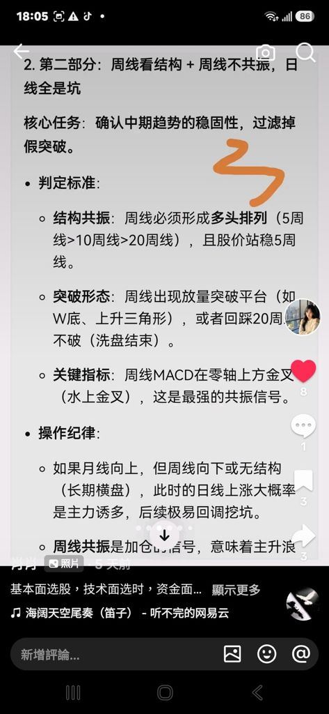

# 週線要多頭排列並站穩 5 週線，才算中期共振

作者把週線當過濾假突破的關卡：除多頭排列外，還要放量突破平台或回踩 20 週線不破，週線 MACD 水上金叉是最強共振訊號；月線向上但週線無結構時，日線上漲多半是主力誘多。未查證。

> 「週線必須形成多頭排列（5週線>10週線>20週線），且股價站穩5週線」
>
> — [[三級K線操盤口訣：月線定生死、周線看結構、日線找爆發#第 3 頁：第二部分：週線看結構、不共振日線全是坑|第 3 頁]]

> [!quote]- 前後文（第 3 頁）
> - [00:03] 2. 第二部分：週線看結構 + 週線不共振，日線全是坑
> - [00:03] 核心任務：確認中期趨勢的穩固性，過濾掉假突破。
> - [00:03] • 判定標準：
> - **[00:03] ○ 結構共振：週線必須形成多頭排列（5週線>10週線>20週線），且股價站穩5週線。**
> - [00:03] ○ 突破形態：週線出現放量突破平台（如W底、上升三角形），或者回踩20週線不破（洗盤結束）。
> - [00:03] ○ 關鍵指標：週線MACD在零軸上方金叉（水上金叉），這是最強的共振訊號。
> - [00:03] • 操作紀律：
> - [00:03] ○ 如果月線向上，但週線向下或無結構（長期橫盤），此時的日線上漲大機率是主力誘多，後續極易回調挖坑。
> - [00:03] ○ 週線共振是加倉的訊號，意味著主升浪（下文被截斷）

**標示：** 作者主張，未查證

## 出處

- [[三級K線操盤口訣：月線定生死、周線看結構、日線找爆發#第 3 頁：第二部分：週線看結構、不共振日線全是坑|三級K線操盤口訣：月線定生死、周線看結構、日線找爆發]]（第 3 頁）
