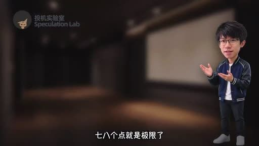

# 倉位是倒著算：先定單筆最多虧多少

講者說 J Law 平時一筆只虧帳戶的千分之三左右。舉例：十萬美元帳戶一筆最多虧 350 美元，100 美元買進、95 美元止損，每股虧 5 美元就買 70 股，漲到 125 美元賺 1750 美元，正好是虧損的五倍。被止損也不用急，形態沒壞就按計劃買回來。

> 「是倒著算限定這一筆最多」
>
> — [[投機實驗室 - 100萬美元組交易雙冠王就是他。  香港教師J Law轉行做交易員後天賦就全出來了，把100萬美元兩年做到1600萬，拿下美國投資錦標賽1...#主題 6：第 4 步：定止損與倉位（03:41–04:41）|03:58]]

> [!quote]- 前後文（03:47–04:07）
> - [03:47] 的就放在那幾樣支撐的下
> - [03:49] 面都不能正好放在支撐線
> - [03:51] 上要留一點空間不然價格
> - [03:53] 稍微跌穿一下就被掃出去
> - [03:54] 了止損最好在三到五個點
> - [03:56] 七八個點就是極限了倉位
> - **[03:58] 是倒著算限定這一筆最多**
> - [04:00] 虧帳戶的多少他平時一筆
> - [04:02] 只虧帳戶的千分之三左右
> - [04:04] 比如十萬美元的帳戶一筆
> - [04:05] 最多虧三百五十美元一百
> - [04:07] 美元買進九十五美元止損

**標示：** 講者主張，未查證

## 出處

- [[投機實驗室 - 100萬美元組交易雙冠王就是他。  香港教師J Law轉行做交易員後天賦就全出來了，把100萬美元兩年做到1600萬，拿下美國投資錦標賽1...#主題 6：第 4 步：定止損與倉位（03:41–04:41）|投機實驗室 - 100萬美元組交易雙冠王就是他。  香港教師J Law轉行做交易員後天賦就全出來了，把100萬美元兩年做到1600萬，拿下美國投資錦標賽1...]]（03:58）
