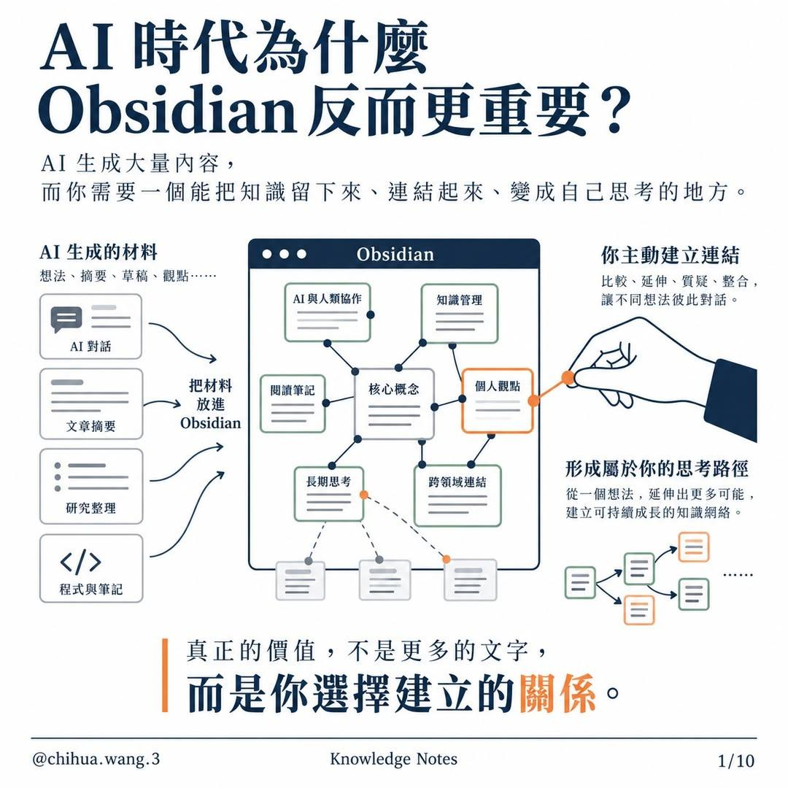

# 價值在於人選擇建立的關係

AI 能生成大量內容，但留下什麼、與什麼連結由人選；價值來自這些關係，不來自文字量。

> 「真正的價值，不是更多的文字，而是你選擇建立的關係。」
>
> — [[AI 時代為什麼 Obsidian 反而更重要？#第 1 頁：AI 時代為什麼 Obsidian 反而更重要？|第 1 頁]]

> [!quote]- 前後文（第 1 頁）
> - [00:01] AI 時代為什麼 Obsidian 反而更重要？
> - [00:01] AI 生成大量內容，而你需要一個能把知識留下來、連結起來、變成自己思考的地方。
> - [00:01] 左：AI 生成的材料（想法、摘要、草稿、觀點……）＝AI 對話、文章摘要、研究整理、程式與筆記 → 把材料放進 Obsidian。
> - [00:01] 中：Obsidian 圖譜（AI 與人類協作、知識管理、閱讀筆記、核心概念、個人觀點、長期思考、跨領域連結）。
> - [00:01] 右：你主動建立連結（比較、延伸、質疑、整合，讓不同想法彼此對話）；形成屬於你的思考路徑（從一個想法，延伸出更多可能，建立可持續成長的知識網絡）。
> - **[00:01] 結語：真正的價值，不是更多的文字，而是你選擇建立的關係。**

**標示：** 講者／作者主張，未查證

## 出處

- [[AI 時代為什麼 Obsidian 反而更重要？#第 1 頁：AI 時代為什麼 Obsidian 反而更重要？|AI 時代為什麼 Obsidian 反而更重要？]]（第 1 頁）
