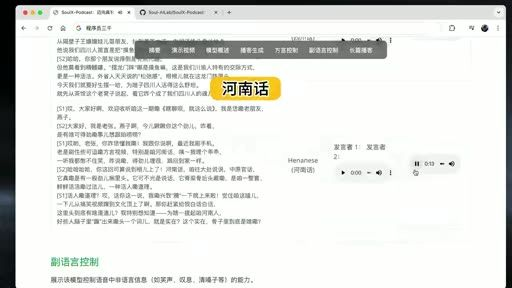

# 副語言控制：用標籤加入笑聲、嘆息、清嗓

講者說只要在文字裡加入一些非語音標籤，AI 就能實現笑聲、嘆息、清嗓子等副語言效果，讓真實感直接拉滿；畫面標示為「笑聲、嘆息聲、清嗓聲等」，專案頁稱支援各種副語言事件（講者主張，未查證）。

> 「我們只需要在文字里加入一些非語音的標籤AI也能實現笑聲嘆息清嗓子真實感直接拉滿」
>
> — [[Github一開源，就登頂？一口氣合成90分鐘音訊～#主題 4：示範二：副語言控制（笑聲、嘆息、清嗓）（01:10–01:40）|01:11]]

> [!quote]- 前後文（01:03–01:29）
> - [01:03] 瞎聊白就這麼說
> - [01:04] 我是人類撈朋友燕子
> - [01:06] 大家好我是老掌
> - [01:08] 燕子
> - [01:08] 就是抽抽你這個勁
> - [01:10] 咋做
> - **[01:11] 是有啥課得進來的事想跟咱撈撈不語音控制我們只需要在文字里加入一些非語音的標籤AI也能實現笑聲嘆息清嗓子真實感直接拉滿**
> - [01:21] 一個充滿了未來感
> - [01:23] 然後還有一點點神經質的播客節目
> - [01:27] 我是主持人小西
> - [01:28] 最近活得特別賽博朋克
> - [01:29] 以前覺得AI是科幻片裡的

**標示：** 講者主張，未查證

## 出處

- [[Github一開源，就登頂？一口氣合成90分鐘音訊～#主題 4：示範二：副語言控制（笑聲、嘆息、清嗓）（01:10–01:40）|Github一開源，就登頂？一口氣合成90分鐘音訊～]]（01:11）
