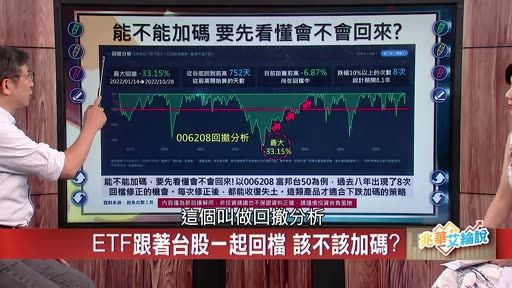

# 加碼前先回測：跌下去會不會回來

不看會不會繼續漲，只看每次下跌後能否收復；市值型多半能回來，才值得逢低加碼。

> 「這個叫做回測分析啊」
>
> — 03:49

**標示：** 講者主張，未查證

## 連結

- [[逢低加碼]]｜上位概念：回測是決定能否加碼的前提

## 出處

- [[【兆華艾綸說】ETF逢低撿 金字塔加碼法 市值、正2、高息型 全都解｜李兆華、艾綸、股魚 2026.10.21 part2]]（03:49）
