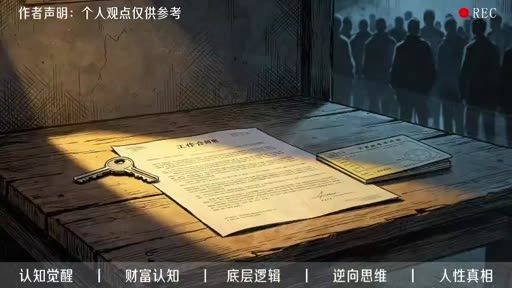

# 先把錢扣下來，剩下的才拿去花

講者轉述芒格的第一個習慣：普通人是賺多少花多少、剩多少存多少，芒格完全倒過來，先把錢扣下來，剩下的才花，目標是先攢夠人生第一個十萬。講者說存錢不是摳門，是給自己買選擇權：有存款時好機會來了接得住，低谷來了也不必被迫接爛工作。

> 「先把錢扣下來」
>
> — [[大鵬財商 - 一個人財富積累最快的方式，不是拼命尋找成功秘訣，而是直接複製查理·芒格的10個終身習慣。  芒格有一句非常經典的話：  “如果我知道自己會...#主題 2：第 1 條：先攢夠人生第一個十萬（00:58–01:25）|01:07]]

> [!quote]- 前後文（00:58–01:14）
> - [00:58] 第一
> - [00:59] 先攢夠你人生第一個十萬
> - [01:01] 普通人花錢的順序是
> - [01:03] 掙多少花多少
> - [01:04] 剩多少存多少
> - [01:05] 芒格完全倒過來
> - **[01:07] 先把錢扣下來**
> - [01:08] 剩下的才拿去花
> - [01:10] 存錢不是摳門
> - [01:11] 是給自己買選擇權
> - [01:13] 手裡有存款
> - [01:14] 好機會來了

**標示：** 講者主張，未查證

## 出處

- [[大鵬財商 - 一個人財富積累最快的方式，不是拼命尋找成功秘訣，而是直接複製查理·芒格的10個終身習慣。  芒格有一句非常經典的話：  “如果我知道自己會...#主題 2：第 1 條：先攢夠人生第一個十萬（00:58–01:25）|大鵬財商 - 一個人財富積累最快的方式，不是拼命尋找成功秘訣，而是直接複製查理·芒格的10個終身習慣。  芒格有一句非常經典的話：  “如果我知道自己會...]]（01:07）
