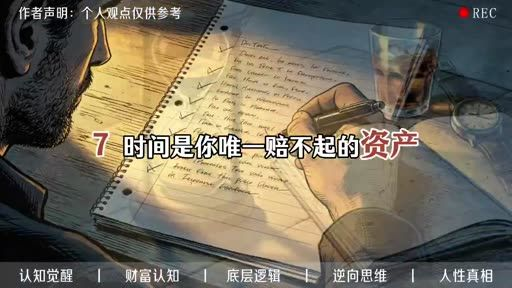

# 用「五年後還重要嗎」過濾事情

講者說芒格很少把時間浪費在無意義的娛樂上，做任何事之前都會問自己這件事五年後回頭看還重要嗎，答案是否定的就直接砍掉。講者提醒不要用虛假的忙碌掩蓋思維上的懶惰，真正的勤奮是把有限的時間全部砸進長期複利的事。

> 「這件事五年後回頭看」
>
> — [[大鵬財商 - 一個人財富積累最快的方式，不是拼命尋找成功秘訣，而是直接複製查理·芒格的10個終身習慣。  芒格有一句非常經典的話：  “如果我知道自己會...#主題 8：第 7 條：時間是唯一賠不起的資產（04:12–04:34）|04:21]]

> [!quote]- 前後文（04:11–04:28）
> - [04:11] 是保護你的判斷力
> - [04:12] 第七
> - [04:13] 時間是你唯一賠不起的資產
> - [04:16] 芒格很少把時間浪費在無意義的娛樂上
> - [04:19] 做任何事之前
> - [04:20] 他都會問自己
> - **[04:21] 這件事五年後回頭看**
> - [04:23] 還重要嗎
> - [04:24] 答案是否定的
> - [04:25] 直接砍掉
> - [04:26] 不要用虛假的忙碌掩蓋思維上的懶惰
> - [04:28] 真正的勤奮不是不停幹活

**標示：** 講者主張，未查證

## 出處

- [[大鵬財商 - 一個人財富積累最快的方式，不是拼命尋找成功秘訣，而是直接複製查理·芒格的10個終身習慣。  芒格有一句非常經典的話：  “如果我知道自己會...#主題 8：第 7 條：時間是唯一賠不起的資產（04:12–04:34）|大鵬財商 - 一個人財富積累最快的方式，不是拼命尋找成功秘訣，而是直接複製查理·芒格的10個終身習慣。  芒格有一句非常經典的話：  “如果我知道自己會...]]（04:21）
