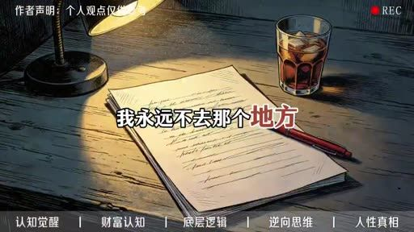

# 研究失敗比研究成功重要：先列出絕對不能碰的事

講者引芒格名言「如果我知道自己會死在哪，我永遠不去那個地方」，說他一輩子研究人是怎麼垮掉的，清單寫的不是要抓住什麼機會，而是哪些事絕對不能碰。講者轉述芒格總結毀掉財富的三樣東西是酒精、慾望、高槓杆，並說看不懂的領域堅決不碰。

> 「如果我知道自己會死在哪」
>
> — [[大鵬財商 - 一個人財富積累最快的方式，不是拼命尋找成功秘訣，而是直接複製查理·芒格的10個終身習慣。  芒格有一句非常經典的話：  “如果我知道自己會...#主題 4：第 3 條：研究失敗比研究成功重要一百倍（01:54–02:31）|02:04]]

> [!quote]- 前後文（01:51–02:15）
> - [01:51] 把知識轉化成判斷力的能力才值錢
> - [01:54] 第三
> - [01:55] 研究失敗比研究成功重要一百倍
> - [01:58] 普通人天天想怎麼快速成功
> - [02:00] 芒格一輩子都在研究人是怎麼垮掉的
> - [02:03] 他那句名言
> - **[02:04] 如果我知道自己會死在哪**
> - [02:06] 我永遠不去那個地方
> - [02:08] 他的清單寫的不是要抓住什麼機會
> - [02:10] 而是哪些事絕對不能碰
> - [02:12] 普通人剛好相反
> - [02:15] 眼裡只看見收益

**標示：** 講者主張，未查證

## 出處

- [[大鵬財商 - 一個人財富積累最快的方式，不是拼命尋找成功秘訣，而是直接複製查理·芒格的10個終身習慣。  芒格有一句非常經典的話：  “如果我知道自己會...#主題 4：第 3 條：研究失敗比研究成功重要一百倍（01:54–02:31）|大鵬財商 - 一個人財富積累最快的方式，不是拼命尋找成功秘訣，而是直接複製查理·芒格的10個終身習慣。  芒格有一句非常經典的話：  “如果我知道自己會...]]（02:04）
