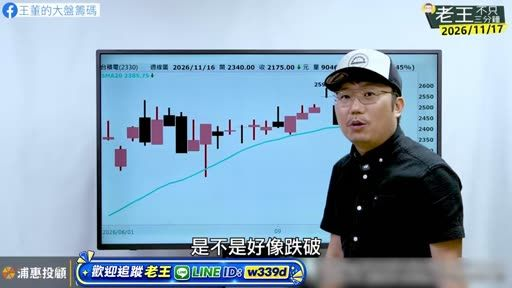

# 20 週均線是長線的分界

講者說他過去分析台積電時就已提醒跌破 20 週均線，並強調那不是事後諸葛，而是先講；從長線角度，要操作價差的人，甚至長期持有的人，都要賣。他沒有說明 20 週均線的計算細節。

> 「不是好像是已經跌破20週均線了」
>
> — [[散戶入侵台積電，罕見的外資和散戶對作誰會笑到最後？#主題 5：20 週均線：長線角度早就跌破（01:45–02:15）|02:01]]

> [!quote]- 前後文（01:51–02:08）
> - [01:51] 20週均線有多重要
> - [01:53] 你看連續兩周啊
> - [01:55] 我記得這個地方我還有分析台積電
> - [01:56] 我說早就跌破20週均線了
> - [01:58] 我那時候小編問說是不是好像跌破
> - [02:00] 我還在這個節目直接說
> - **[02:01] 不是好像是已經跌破20週均線了**
> - [02:04] 所以從長線的角度
> - [02:05] 你是要操作資本利的
> - [02:06] 你要操作價差的
> - [02:07] 你要趕快賣了
> - [02:08] 就算你是長期持有也要賣了

**標示：** 講者主張，未查證

## 出處

- [[散戶入侵台積電，罕見的外資和散戶對作誰會笑到最後？#主題 5：20 週均線：長線角度早就跌破（01:45–02:15）|散戶入侵台積電，罕見的外資和散戶對作誰會笑到最後？]]（02:01）
