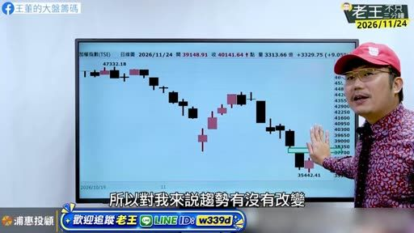

# 不看單一 K 棒，看缺口有沒有被封閉

講者拿上週五的空方缺口舉例：昨天雖然收紅 K 棒，但空方缺口沒有被封閉，所以對他來說趨勢沒有改變；他不會因為一根紅 K 就說要往上漲，而是看缺口是否被封閉。

> 「我不會看單一K棒」
>
> — [[短線翻多訊號：缺口與均線#主題 1：空方缺口沒被封閉，趨勢就沒有改變（00:00–00:21）|00:08]]

> [!quote]- 前後文（00:00–00:21）
> - [00:00] 上週五還有一個空方缺口
> - [00:02] 上週五空方缺口在這裡
> - [00:04] 昨天有封閉這個空方缺口嗎？沒有嘛
> - [00:06] 所以對我來說趨勢有沒有改變？
> - **[00:08] 沒有，我不會看單一K棒**
> - [00:10] 我不會說昨天紅K棒就要往上漲了
> - [00:12] 不會，這不是我的風格
> - [00:13] 我們一定是怎樣？
> - [00:15] 看到今天出現了
> - [00:17] 一個多方缺口出現了
> - [00:19] 把前面的空方缺口給封閉了
> - [00:21] 那就告訴你這就叫做短線的止跌訊號了

**標示：** 講者主張，未查證

## 出處

- [[短線翻多訊號：缺口與均線#主題 1：空方缺口沒被封閉，趨勢就沒有改變（00:00–00:21）|短線翻多訊號：缺口與均線]]（00:08）
