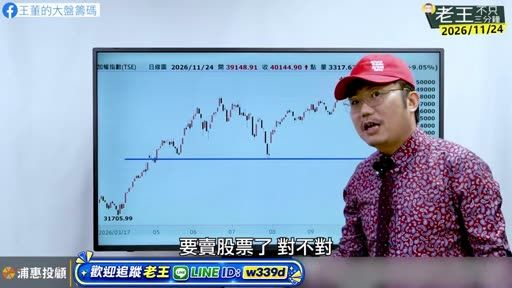

# 假突破接真破底，假破底接真穿頭

講者回顧上週他提醒過在某處假突破，要小心回檔、賣股票，之後果然真破底；現在反過來，剛跌破的位置今天又站回來，他說可能變成假破底要來真穿頭，並說後面持續觀察。

> 「假突破就會接真破底」
>
> — [[短線翻多訊號：缺口與均線#主題 3：為什麼封閉缺口很關鍵：破壞頭部形態（00:50–01:56）|01:23]]

> [!quote]- 前後文（01:14–01:40）
> - [01:14] 我上禮拜有給大家看VCR
> - [01:17] 當時這個地方假突破
> - [01:19] 假突破在這個地方
> - [01:20] 我告訴大家台股假突破
> - [01:21] 要小心要開始回漲修正了
> - [01:22] 要賣股票對不對
> - **[01:23] 假突破就會接真破底**
> - [01:26] 假突破就真的來破底
> - [01:27] 現在反過來，短期間上禮拜剛剛重挫破底
> - [01:32] 結果今天重新站回來了
> - [01:33] 那是不是就會變成假破底要來真穿頭
> - [01:40] 之前是假突破要來真破底

**標示：** 講者主張，未查證

## 出處

- [[短線翻多訊號：缺口與均線#主題 3：為什麼封閉缺口很關鍵：破壞頭部形態（00:50–01:56）|短線翻多訊號：缺口與均線]]（01:23）
