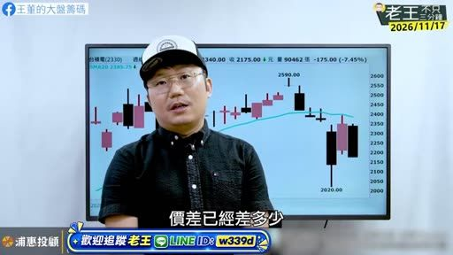

# 基本面好不代表不用看價差，技術分析才是保障

講者承認台積電基本面、財報、產業都很好，但說抱著的人要看這樣一來一回少賺多少價差；他主張不要再說技術分析沒有用，願意相信技術分析才有保障。

> 「我告訴你技術分析才是保障」
>
> — [[散戶入侵台積電，罕見的外資和散戶對作誰會笑到最後？#主題 6：基本面再好，技術分析才是保障（02:15–02:51）|02:31]]

> [!quote]- 前後文（02:22–02:42）
> - [02:22] 那你因為基本面好
> - [02:23] 你因為財報好、產業好
> - [02:25] AI相信AI
> - [02:26] 你是不是台積電還抱著
> - [02:27] 這樣一來一回的價差還差多少
> - [02:29] 所以不要再講技術分析是沒有任何那些東西
> - **[02:31] 我告訴你技術分析才是保障**
> - [02:35] 你願意相信技術分析
> - [02:37] 技術分析又會帶給你多少收穫
> - [02:39] 就是如此而已
> - [02:40] 20週均線講了多少次
> - [02:42] 不是現在馬後炮說因為跌破20週均線

**標示：** 講者主張，未查證

## 出處

- [[散戶入侵台積電，罕見的外資和散戶對作誰會笑到最後？#主題 6：基本面再好，技術分析才是保障（02:15–02:51）|散戶入侵台積電，罕見的外資和散戶對作誰會笑到最後？]]（02:31）
