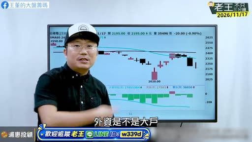

# 外資一路賣、散戶一路接，不是正常的籌碼

講者用台積電的外資買賣超圖說明：這段期間外資只買一天、其餘都在賣，而散戶（100 張以下）拼命接。他說這不是股票正常的籌碼，所以股價反彈上去又跌下來；外資買賣天數為講者口述，未核對。

> 「啊外資大戶一路賣」
>
> — [[散戶入侵台積電，罕見的外資和散戶對作誰會笑到最後？#主題 2：籌碼面在作怪：外資一路賣、散戶一路接（00:30–01:05）|00:51]]

> [!quote]- 前後文（00:42–01:00）
> - [00:42] 有沒有搞錯啊
> - [00:43] 全部都在賣啊
> - [00:46] 這張圖有多少個交易日
> - [00:47] 外資又賣多少天
> - [00:48] 只有一天買超啊
> - [00:50] 啊外資是不是大戶
> - **[00:51] 啊外資大戶一路賣**
> - [00:53] 啊你散戶拼命接
> - [00:54] 這是股票正常的籌碼嗎
> - [00:56] 股票會漲是因為籌碼要夠集中欸
> - [00:58] 大家不是常常在看籌碼集中度嗎？
> - [01:00] 所以這籌碼你要台積電怎麼漲嗎？

**標示：** 講者主張，未查證

## 出處

- [[散戶入侵台積電，罕見的外資和散戶對作誰會笑到最後？#主題 2：籌碼面在作怪：外資一路賣、散戶一路接（00:30–01:05）|散戶入侵台積電，罕見的外資和散戶對作誰會笑到最後？]]（00:51）
