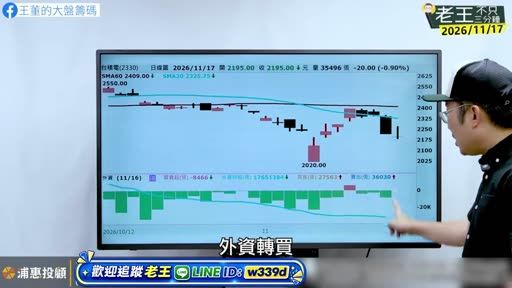

# 好的籌碼結構：散戶掉下來，外資接走

講者希望看到的是散戶受不了、把股票賣出去，然後外資轉買把籌碼接走，他稱這是很棒的籌碼結構，並說必須期待看到這樣的變化。

> 「這就是很棒的籌碼結構」
>
> — [[散戶入侵台積電，罕見的外資和散戶對作誰會笑到最後？#主題 3：理想的籌碼結構：散戶掉下來、外資接走（01:05–01:17）|01:13]]

> [!quote]- 前後文（01:05–01:20）
> - [01:05] 所以我們希望看到是散戶要掉下來
> - [01:07] 散戶這個地方掉下來
> - [01:08] 散戶股票賣出去了
> - [01:10] 散戶受不了了
> - [01:11] 然後誰接走？
> - [01:12] 外資轉買
> - [01:13] 外資接走了
> - **[01:13] 這就是很棒的籌碼結構**
> - [01:15] 你必須要期待看到這樣子
> - [01:17] 再看一下技術面的部分
> - [01:18] 上禮拜站上短期均線
> - [01:20] 甚至一度站上月均線

**標示：** 講者主張，未查證

## 出處

- [[散戶入侵台積電，罕見的外資和散戶對作誰會笑到最後？#主題 3：理想的籌碼結構：散戶掉下來、外資接走（01:05–01:17）|散戶入侵台積電，罕見的外資和散戶對作誰會笑到最後？]]（01:13）
