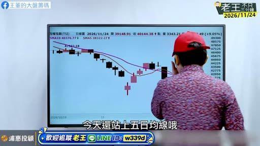

# 站上五日均線代表短線止跌

講者指今天除了多方缺口，也站上五日均線，因此只要持續守住缺口與五日均線，短線就止跌；接下來要面對十日均線，上次站上十日線三天就結束、出現崩跌，所以站上後不能再跌破。

> 「我們常常講站上五日均線代表短線的一個止跌」
>
> — [[短線翻多訊號：缺口與均線#主題 4：守住缺口與五日均線；面對十日均線（01:56–02:49）|01:59]]

> [!quote]- 前後文（01:32–02:11）
> - [01:32] 結果今天重新站回來了
> - [01:33] 那是不是就會變成假破底要來真穿頭
> - [01:40] 之前是假突破要來真破底
> - [01:44] 現在是假破底要來真穿頭我們後面可以持續來做觀察大家可以放在自己的心中期待黃爸爸大顯神威那往下看了
> - [01:56] 那今天有個多方缺口
> - [01:58] 今天還站上五日均線
> - **[01:59] 我們常常講站上五日均線代表短線的一個止跌**
> - [02:02] 所以只要持續守住這個缺口跟五日均線
> - [02:05] 短線就止跌這沒有問題
> - [02:06] 一定是封閉缺口才會結束
> - [02:08] 那接下來馬上面對到十日均線
> - [02:11] 上一次有站上十日均線

**標示：** 講者主張，未查證

## 出處

- [[短線翻多訊號：缺口與均線#主題 4：守住缺口與五日均線；面對十日均線（01:56–02:49）|短線翻多訊號：缺口與均線]]（01:59）
