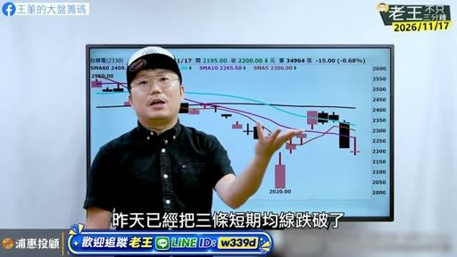

# 站上均線只一天又跌破：三聲無奈，長短線都是空頭

講者說上週站上短期均線、一度站上月均線卻只站一天，昨天已把三條短期均線跌破，所以長線、短線都是空頭；要翻多，他的條件是看到所有均線都站上，往下則要看前面的低點能不能守住。

> 「所以又再次變成三聲無奈」
>
> — [[散戶入侵台積電，罕見的外資和散戶對作誰會笑到最後？#主題 4：技術面：站上短均又跌破，長短線都是空頭（01:17–01:45）|01:27]]

> [!quote]- 前後文（01:17–01:46）
> - [01:17] 再看一下技術面的部分
> - [01:18] 上禮拜站上短期均線
> - [01:20] 甚至一度站上月均線
> - [01:22] 只站上一天
> - [01:23] 然後又開始跌下來呢
> - [01:24] 昨天已經把三條短期均線跌破了
> - **[01:27] 所以又再次變成三聲無奈**
> - [01:29] 長線、短線都是空頭
> - [01:31] 在日K線的部分當然未來就持續往下走你一定是要看到把所有均線站上四海遊龍長線才能翻多技術面是這樣看不然的話往下走呢如果走一個長角
> - [01:42] 要觀察這一個前面的低點能不能守住啊
> - [01:45] 這樣能夠理解嗎
> - [01:46] 從長線的週期來說

**標示：** 講者主張，未查證

## 出處

- [[散戶入侵台積電，罕見的外資和散戶對作誰會笑到最後？#主題 4：技術面：站上短均又跌破，長短線都是空頭（01:17–01:45）|散戶入侵台積電，罕見的外資和散戶對作誰會笑到最後？]]（01:27）
