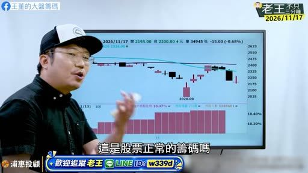

# 股票要漲，籌碼要夠集中

講者認為股票會漲是因為籌碼夠集中，並說大家常看的籌碼集中度就是這個意思；台積電這段時間是散戶接、外資賣，籌碼不集中，所以漲不上去。

> 「股票會漲是因為籌碼要夠集中欸」
>
> — [[散戶入侵台積電，罕見的外資和散戶對作誰會笑到最後？#主題 2：籌碼面在作怪：外資一路賣、散戶一路接（00:30–01:05）|00:56]]

> [!quote]- 前後文（00:47–01:05）
> - [00:47] 外資又賣多少天
> - [00:48] 只有一天買超啊
> - [00:50] 啊外資是不是大戶
> - [00:51] 啊外資大戶一路賣
> - [00:53] 啊你散戶拼命接
> - [00:54] 這是股票正常的籌碼嗎
> - **[00:56] 股票會漲是因為籌碼要夠集中欸**
> - [00:58] 大家不是常常在看籌碼集中度嗎？
> - [01:00] 所以這籌碼你要台積電怎麼漲嗎？
> - [01:02] 所以才會在反彈上去又跌下來了嘛
> - [01:04] 因為你是散戶在買啊
> - [01:05] 所以我們希望看到是散戶要掉下來

**標示：** 講者主張，未查證

## 出處

- [[散戶入侵台積電，罕見的外資和散戶對作誰會笑到最後？#主題 2：籌碼面在作怪：外資一路賣、散戶一路接（00:30–01:05）|散戶入侵台積電，罕見的外資和散戶對作誰會笑到最後？]]（00:56）
