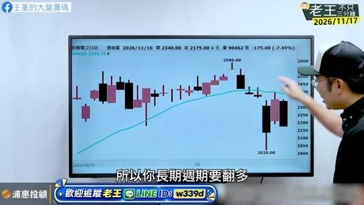

# 賣掉後，等 20 週均線站回再買回

講者說上週反彈沒有站上 20 週均線，所以長期沒有翻多；若前面已賣掉，要等到 20 週均線站上去再買回，而且這兩週賣掉的人，等站回 20 週時搞不好還買得更便宜。

> 「你前面有賣掉了你就要把它買回來」
>
> — [[散戶入侵台積電，罕見的外資和散戶對作誰會笑到最後？#主題 7：還沒站回 20 週均線，長線就沒翻多（02:51–03:13）|03:02]]

> [!quote]- 前後文（02:54–03:12）
> - [02:54] 有沒有站上20週均線
> - [02:56] 沒有
> - [02:56] 所以長期週期有翻多嗎
> - [02:58] 沒有
> - [02:59] 所以這禮拜又下來了
> - [03:00] 所以你長期週期要翻多
> - **[03:02] 你前面有賣掉了你就要把它買回來**
> - [03:04] 就等到20週均線站上去啦
> - [03:06] 事實上你這兩週有賣
> - [03:07] 真的台積電站回來20週
> - [03:10] 搞不好你都還買得還比較便宜
> - [03:12] 你說是不是

**標示：** 講者主張，未查證

## 出處

- [[散戶入侵台積電，罕見的外資和散戶對作誰會笑到最後？#主題 7：還沒站回 20 週均線，長線就沒翻多（02:51–03:13）|散戶入侵台積電，罕見的外資和散戶對作誰會笑到最後？]]（03:02）
