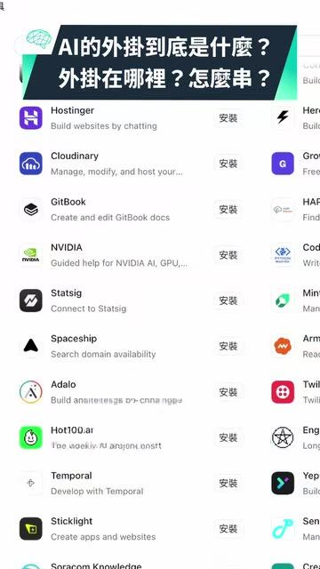

# ChatGPT 連接外掛的路徑：左上角外掛程式／Apps

講者說 ChatGPT 比較好找，名稱依中英文介面不同，App 已分門別類，可點分類看更多；操作同樣是點進去、跳授權畫面按同意。

> 「在左上角點外掛程式或是Apps」
>
> — [[AI 外掛：Claude Connector 與 ChatGPT App 怎麼用#主題 3：ChatGPT 怎麼設定外掛（00:42–01:00）|00:44]]

> [!quote]- 前後文（00:26–01:00）
> - [00:26] 它會顯示出來的是你已經有連的Connectors
> - [00:30] 你要再點選Discover就可以看到一個外掛目錄
> - [00:33] 右邊還有Filter可以篩選外掛的型別
> - [00:36] 想要連哪一個直接點進去就好
> - [00:39] 跳出來的畫面按授權就OK啦
> - [00:42] ChatGPT 就比較好找一點
> - **[00:44] 在左上角點外掛程式或是Apps**
> - [00:47] 就是看你是中文還是英文模式
> - [00:49] 它已經把App分門別類了
> - [00:52] 可以點進去分類裡面的看更多App
> - [00:55] 操作方式一樣是點進去跳授權畫面按同意就好啦
> - [01:00] 我自己第一次連的時候其實有一點意外

**標示：** 講者／作者主張，未查證

## 出處

- [[AI 外掛：Claude Connector 與 ChatGPT App 怎麼用#主題 3：ChatGPT 怎麼設定外掛（00:42–01:00）|AI 外掛：Claude Connector 與 ChatGPT App 怎麼用]]（00:44）
