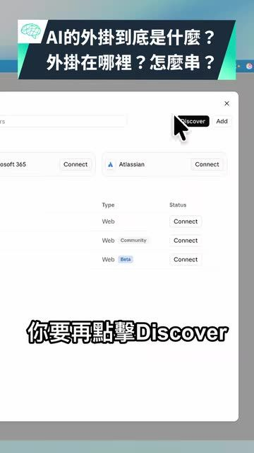

# Claude 連接外掛的路徑：Settings → Customize → Connectors → Discover

依影片示範：左下角 Settings、Customize、Connectors 會列出已連的外掛，再點 Discover 看外掛目錄，右邊有 Filter 可篩類型，點進去按授權即可。介面為拍攝當時的版本，可能已變動。

> 「你要再點選Discover就可以看到一個外掛目錄」
>
> — [[AI 外掛：Claude Connector 與 ChatGPT App 怎麼用#主題 2：Claude 怎麼設定外掛（00:18–00:42）|00:30]]

> [!quote]- 前後文（00:15–00:44）
> - [00:15] 現在可以全部在對話方塊裡面完成
> - [00:18] 要怎麼設定呢？
> - [00:19] Claude這邊你可以點這個左下角的Settings
> - [00:23] 找到Customize
> - [00:24] 點進去找到Connectors
> - [00:26] 它會顯示出來的是你已經有連的Connectors
> - **[00:30] 你要再點選Discover就可以看到一個外掛目錄**
> - [00:33] 右邊還有Filter可以篩選外掛的型別
> - [00:36] 想要連哪一個直接點進去就好
> - [00:39] 跳出來的畫面按授權就OK啦
> - [00:42] ChatGPT 就比較好找一點
> - [00:44] 在左上角點外掛程式或是Apps

**標示：** 講者／作者主張，未查證

## 出處

- [[AI 外掛：Claude Connector 與 ChatGPT App 怎麼用#主題 2：Claude 怎麼設定外掛（00:18–00:42）|AI 外掛：Claude Connector 與 ChatGPT App 怎麼用]]（00:30）
