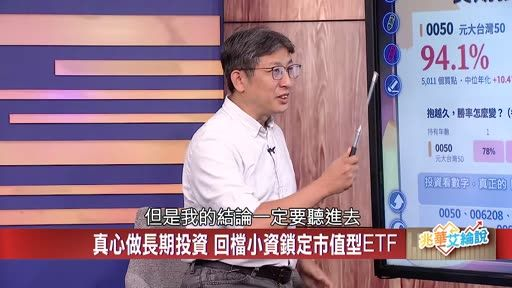

# 市值型持有越久勝率越高

以 0050 為例，持有 1 年勝率約八成、3 年約九成、5 年以上接近 100%（2003–2026 回測）。

> 「然後堅持抱至少三年以上」
>
> — 19:00

**標示：** 講者主張，未查證

## 出處

- [[【兆華艾綸說】ETF逢低撿 金字塔加碼法 市值、正2、高息型 全都解｜李兆華、艾綸、股魚 2026.10.21 part2]]（19:00）
