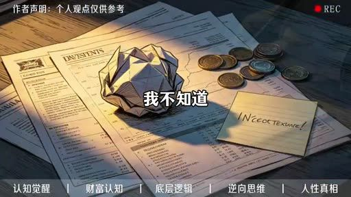

# 承認「我不知道」是對抗過度自信的第一步

講者轉述芒格：人的大腦天生帶偏見，很容易過度自信、自我欺騙，對抗的第一步是坦然說出「我不知道」，而不是虧了錢騙自己只是暫時回撥、搞砸就怪運氣差。年輕的芒格曾因自負錯過優質投資，之後建立雙軌分析法：先理性判斷對錯，再審視自己有沒有被情緒裹挾；真正的智慧是清楚自己能力的邊界。

> 「我不知道」
>
> — [[大鵬財商 - 一個人財富積累最快的方式，不是拼命尋找成功秘訣，而是直接複製查理·芒格的10個終身習慣。  芒格有一句非常經典的話：  “如果我知道自己會...#主題 6：第 5 條：承認自己無知（03:05–03:45）|03:21]]

> [!quote]- 前後文（02:55–03:37）
> - [02:55] 不是追求長壽
> - [02:56] 是守住清醒的大腦和穩定的執行力
> - [03:00] 太多年輕人拿健康換短期收入
> - [03:03] 等到中年想發力
> - [03:05] 身體早就廢了第五，承認自己無知是最反人性的生存技巧芒格說，能意識到自己愚蠢是件值得慶幸的事。人的大腦天生帶偏見，很容易過度自信，自我欺騙。
> - [03:18] 對抗他的第一步就是坦然說出四個字，
> - **[03:21] 我不知道，很多人虧了錢騙自己，只是暫時回撥，**
> - [03:25] 事情搞砸就怪運氣差，不肯認錯，錯誤只會越滾越大。
> - [03:29] 年輕的芒格也曾因為自負錯過優質投資，
> - [03:33] 之後他建立了雙軌分析法，
> - [03:35] 一件事先理性判斷對錯
> - [03:37] 再審視自己有沒有被情緒裹挾

**標示：** 講者主張，未查證

## 出處

- [[大鵬財商 - 一個人財富積累最快的方式，不是拼命尋找成功秘訣，而是直接複製查理·芒格的10個終身習慣。  芒格有一句非常經典的話：  “如果我知道自己會...#主題 6：第 5 條：承認自己無知（03:05–03:45）|大鵬財商 - 一個人財富積累最快的方式，不是拼命尋找成功秘訣，而是直接複製查理·芒格的10個終身習慣。  芒格有一句非常經典的話：  “如果我知道自己會...]]（03:21）
