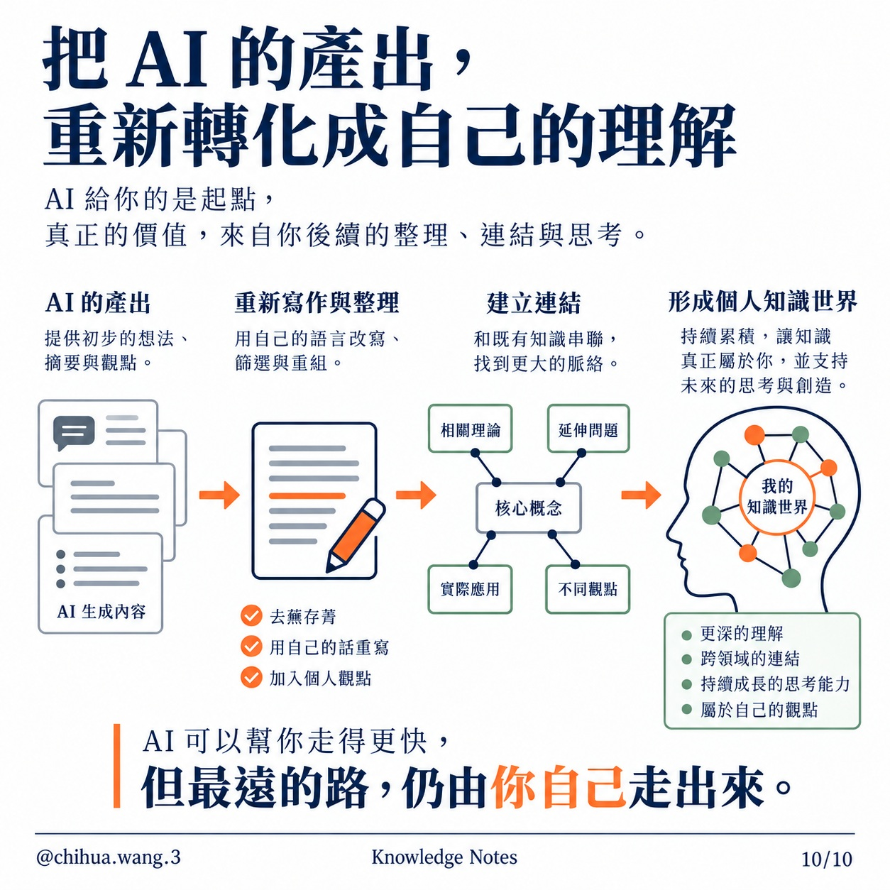

# 把 AI 的產出重寫成自己的理解

第 10 頁把流程分成四步：AI 產出提供初步想法與摘要 → 用自己的語言改寫、篩選、去蕪存菁並加入個人觀點 → 和既有知識串聯，連到相關理論、延伸問題與不同觀點 → 持續累積成個人知識世界。作者認為 AI 給的只是起點，價值來自後續的整理、連結與思考。

> 「AI 可以幫你走得更快，但最遠的路，仍由你自己走出來。」
>
> — [[AI 時代為什麼 Obsidian 反而更重要？#第 10 頁：把 AI 的產出，重新轉化成自己的理解|第 10 頁]]

> [!quote]- 前後文（第 10 頁）
> - [00:10] 把 AI 的產出，重新轉化成自己的理解
> - [00:10] AI 給你的是起點，真正的價值，來自你後續的整理、連結與思考。
> - [00:10] AI 的產出：提供初步的想法、摘要與觀點（AI 生成內容）。
> - [00:10] 重新寫作與整理：用自己的語言改寫、篩選與重組；去蕪存菁、用自己的話重寫、加入個人觀點。
> - [00:10] 建立連結：和既有知識串聯，找到更大的脈絡；核心概念連相關理論、延伸問題、實際應用、不同觀點。
> - [00:10] 形成個人知識世界：持續累積，讓知識真正屬於你，並支持未來的思考與創造；更深的理解、跨領域的連結、持續成長的思考能力、屬於自己的觀點。
> - **[00:10] 結語：AI 可以幫你走得更快，但最遠的路，仍由你自己走出來。**

**標示：** 講者／作者主張，未查證

## 出處

- [[AI 時代為什麼 Obsidian 反而更重要？#第 10 頁：把 AI 的產出，重新轉化成自己的理解|AI 時代為什麼 Obsidian 反而更重要？]]（第 10 頁）
