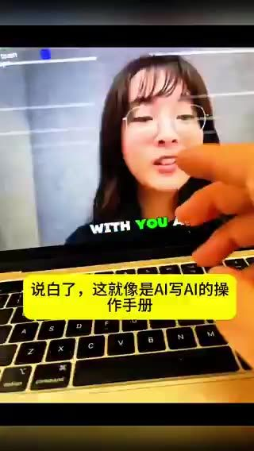

# 把成功的對話存成技能，等於 AI 寫的操作手冊

講者轉述她的做法：AI 幹完活就忘，所以每回 AI 幹成一件事就跟它說「把剛才的方法存成技能」，就像 AI 寫 AI 的操作手冊；例如花一小時教它按你的格式整理會議紀要，存成技能後下次說一句「整理會議紀要」它就照做，技能還要備份到 GitHub，累積成公司資產（講者轉述，未查證）。

> 「存成技能說白了」
>
> — [[永動之初 - 這個講的太好了 一個不會寫程式碼的女生，憑什麼當上馬斯克AI團隊負責人？#主題 6：方法四：把成功的對話存成技能（01:52–02:20）|02:04]]

> [!quote]- 前後文（01:54–02:12）
> - [01:54] 幹完活就忘下回還得從頭
> - [01:56] 教這不白折騰嗎
> - [01:57] 它直接把 AI
> - [01:58] 的不錯的那一次對話存成技能
> - [02:00] 每回 AI 幹成一件事你就跟它說一句
> - [02:03] 把剛才知道方法
> - **[02:04] 存成技能說白了**
> - [02:06] 這就像是 AI 寫 AI 的操作手冊
> - [02:08] 你花一個小時
> - [02:09] 教它按你的格式整理會議紀要
> - [02:11] 回頭存成技能
> - [02:12] 下次你只要說一句整理會議紀要

**標示：** 講者主張，未查證

## 出處

- [[永動之初 - 這個講的太好了 一個不會寫程式碼的女生，憑什麼當上馬斯克AI團隊負責人？#主題 6：方法四：把成功的對話存成技能（01:52–02:20）|永動之初 - 這個講的太好了 一個不會寫程式碼的女生，憑什麼當上馬斯克AI團隊負責人？]]（02:04）
