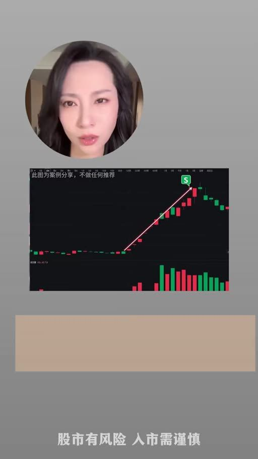

# 主力在最高點根本出不了多少貨

講者說主力不是在一輪上漲的最高點出貨，因為在最高點根本出不了多少，主升浪前大部分籌碼都在主力手上（講者主張，未查證）。

> 「主力在最高點根本出不了多少」
>
> — [[山姐：主力如何利用散戶抄底心理出貨#主題 1：開場：股價越跌，散戶越敢抄底，主力反而越高興（00:00–00:35）|00:13]]

> [!quote]- 前後文（00:00–00:43）
> - [00:00] 你以為是股價越跌散戶越買，主力等於給散戶減便宜籌碼的機會，覺得主力是吃了大虧對不對？
> - [00:08] 事實是股價越跌散戶越敢抄底，主力是越高興的。
> - **[00:13] 或者說你以為主力是在一輪上漲的最高點出貨，事實是主力在最高點根本出不了多少，因為主升浪前幾乎大部分的籌碼都是在主力的手上的。**
> - [00:26] 其實只要玩過股票的人應該都知道，高點價格持續不了多久
> - [00:31] 因為只要主力開始出貨了，很快這個股價就砸下來了
> - [00:35] 而散戶一看跌了，第一反應就跟你一樣，覺得只要跌的夠狠夠多，就可以抄底了
> - [00:43] 結果沒想到主力早就看透了散戶的想法，就是在下跌的過程中才打算出貨的

**標示：** 講者主張，未查證

## 出處

- [[山姐：主力如何利用散戶抄底心理出貨#主題 1：開場：股價越跌，散戶越敢抄底，主力反而越高興（00:00–00:35）|山姐：主力如何利用散戶抄底心理出貨]]（00:13）
