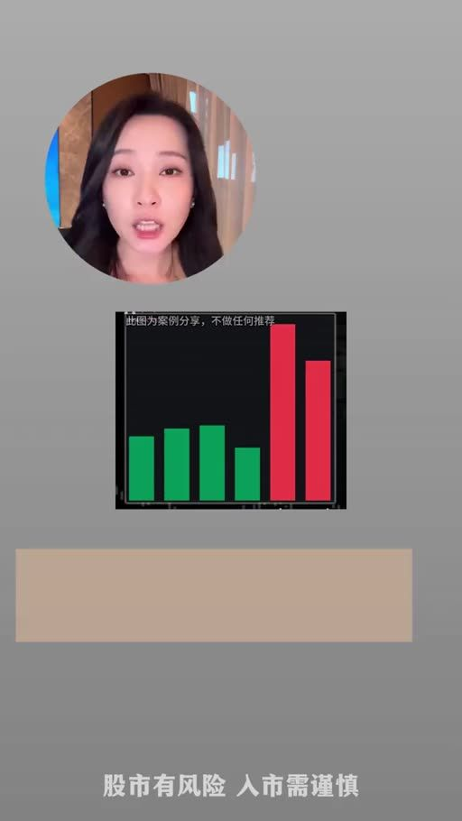

# 低量柱：市場沉默，預示變盤

至少 5 天裡出現的最小量柱即為低量柱（例：一週其他天日均五六十萬、某天僅 25 萬）。講者說這代表交易活躍度極低：賣方嫌價格太低不願賣、買方暗中等待；風險相對較小、機會更大，往往預示變盤在即。

> 「往往預示著變盤在即」
>
> — [[成交量六種量柱形態：看懂主力真實意圖#主題 5：第四種：低量柱——市場的沉默訊號（02:38–03:16）|03:14]]

> [!quote]- 前後文（03:01–03:22）
> - [03:01] 就意味著這個市場的交易活躍度極低了
> - [03:04] 賣方因價格過低而不願意出售
> - [03:07] 買方則在暗中等待更佳的時機
> - [03:11] 這種情況下
> - [03:12] 風險相對較小
> - [03:13] 機會更大
> - **[03:14] 往往預示著變盤在即**
> - [03:16] 第五種
> - [03:17] 倍量柱
> - [03:19] 倍量柱呢
> - [03:20] 是資金進攻的訊號
> - [03:22] 最低標準呢

**標示：** 講者主張，未查證

## 出處

- [[成交量六種量柱形態：看懂主力真實意圖#主題 5：第四種：低量柱——市場的沉默訊號（02:38–03:16）|成交量六種量柱形態：看懂主力真實意圖]]（03:14）
