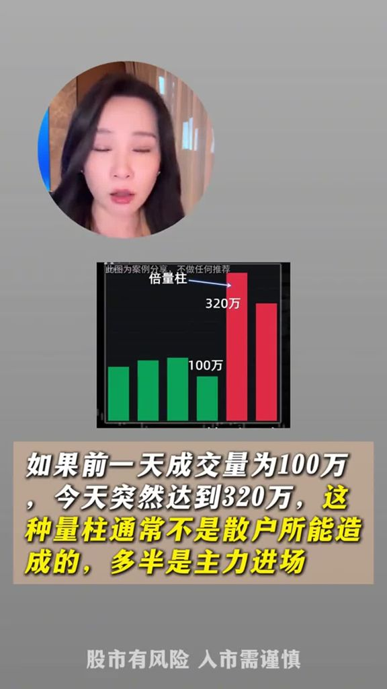

# 倍量柱：資金進攻，放量突破均線時看拉升

倍量柱的最低標準是比前一天量柱高出 90% 以上，甚至是前一天的兩到三倍（例：前一天 100 萬、今天 320 萬）。講者認為這種量不是散戶能造成的，多半是主力進場；尤其在股價面臨壓力位或關鍵均線被放量突破時，往往意味新一輪拉升即將開始。

> 「多半是主力進場」
>
> — [[成交量六種量柱形態：看懂主力真實意圖#主題 6：第五種：倍量柱——資金進攻的訊號（03:16–03:49）|03:38]]

> [!quote]- 前後文（03:23–03:50）
> - [03:23] 是比前一天的量柱呢
> - [03:25] 高出90%以上
> - [03:27] 甚至呢可能是前一天的兩到三倍
> - [03:31] 如果說前一天的成交量為100萬
> - [03:33] 今天突然就達到320萬
> - [03:35] 那麼這種量柱通常不是散戶能夠造成的
> - **[03:38] 多半是主力進場**
> - [03:40] 特別是在股價面臨壓力位
> - [03:43] 或者說是關鍵均線被放量突破的時候
> - [03:46] 往往是意味著新一輪拉升即將要開始
> - [03:49] 第六種
> - [03:50] 平量柱

**標示：** 講者主張，未查證

## 連結

- [[移動平均線]]｜實際應用：放量突破關鍵均線作為拉升訊號

## 出處

- [[成交量六種量柱形態：看懂主力真實意圖#主題 6：第五種：倍量柱——資金進攻的訊號（03:16–03:49）|成交量六種量柱形態：看懂主力真實意圖]]（03:38）
