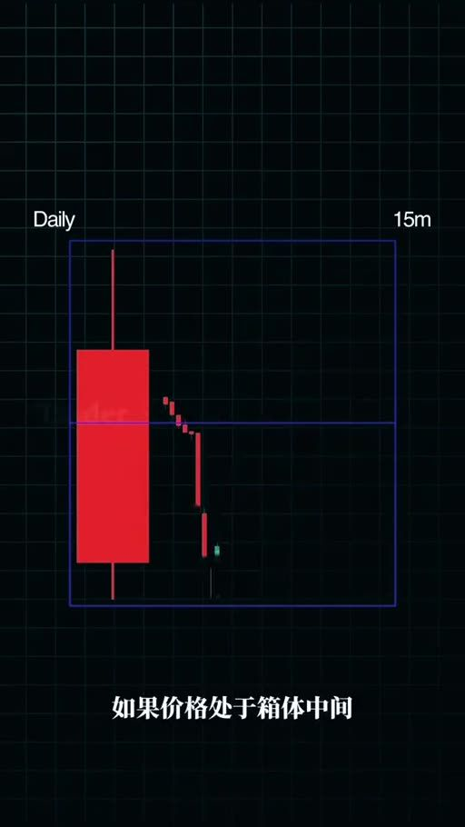

# 價格在箱體中間就什麼都別做

講者說如果價格處於箱體中間，就什麼都別做；這樣一來你交易的是機構方向，而不是隨便亂進場（講者主張，未查證）。

> 「那就什麼都別做」
>
> — [[5年才學會的交易秘密#主題 3：步驟二：切到 15 分鐘圖，依價格位置決定多空（00:25–00:46）|00:41]]

> [!quote]- 前後文（00:32–00:47）
> - [00:32] 目標看向箱體底部
> - [00:33] 如果價格執行在箱體底部
> - [00:35] 說明買方掌控市場
> - [00:36] 這種情況下只考慮做多
> - [00:38] 目標看向箱體頂部
> - [00:39] 如果價格處於箱體中間
> - **[00:41] 那就什麼都別做**
> - [00:42] 這樣一來
> - [00:43] 你交易的就是機構方向
> - [00:45] 而不是隨便亂進場
> - [00:46] 接下來重點來了
> - [00:47] 當價格來到箱體底部時

**標示：** 講者主張，未查證

## 出處

- [[5年才學會的交易秘密#主題 3：步驟二：切到 15 分鐘圖，依價格位置決定多空（00:25–00:46）|5年才學會的交易秘密]]（00:41）
