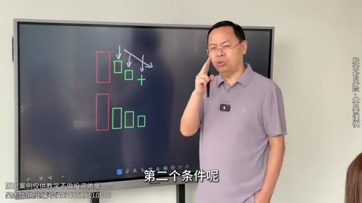

# 價縮量縮：空方力量衰竭的訊號

講者說主力入場後要看空方力量衰竭，需有兩點：價格連續收縮（例：第一根 K 線跌 5 個點、第二根跌 3 個點、第三根跌 1 個點，跌幅越來越小，為講者舉例），且成交量也逐步下降；價格連續縮、量也連續縮，說明真正的空方力量開始衰竭（講者主張，未查證）。

> 「價格連續縮，量也連續縮」
>
> — [[股票#主題 4：條件二（二）：成交量同步收縮，出現最低量與最低價（00:48–01:14）|00:51]]

> [!quote]- 前後文（00:22–01:07）
> - [00:22] 同時有量的一根大陽線先要出來
> - [00:25] 如果連一根大陽線都沒出來的話呢
> - [00:27] 請問主力資金有沒有入場
> - [00:29] 第二個，主力入場後，看到空方力量的衰竭，必須有兩個條件
> - [00:38] 第一，價格是連續縮的，比如說，第一根K線跌5個點，第二個K線跌3個點，第三個K線可能跌1個點，價格是越來越跌的
> - [00:48] 第二個條件，量是越來越縮的
> - **[00:51] 第二個條件，它的成交量要逐步下跌的，價格連續縮，量也連續縮，說明什麼？**
> - [00:57] 說明真正的空方力量開始衰竭了
> - [01:01] 沒有人賣了
> - [01:03] 這個地方出現一個最低的量
> - [01:05] 同時有個最低的價
> - [01:07] 說明這個地方賣的人已經沒有力量再往下拋了

**標示：** 講者主張，未查證

## 出處

- [[股票#主題 4：條件二（二）：成交量同步收縮，出現最低量與最低價（00:48–01:14）|股票]]（00:51）
