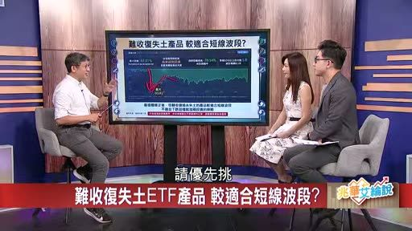

# 優先挑連結股票的 ETF

股魚提醒，連結選擇權、期貨、REITs、特別股等收益型產品的 ETF，一旦遇到大幅回檔，產品連結的信心會潰散，之後可能回不來。所以挑 ETF 時優先選背後連結股票的產品，通常比較容易收復；槓桿也分商品型、股票型等，要看清楚名稱與連結標的。

> 「請優先挑它後面連結的是股票型的產品」
>
> — [[【兆華艾綸說】ETF逢低撿 金字塔加碼法 市值、正2、高息型 全都解｜李兆華、艾綸、股魚 2026.10.21 part2#主題 3：不會回來的產品：連結選擇權、期貨與收益型（05:55–07:30）|06:52]] · [▶ 原影片 06:52](https://www.youtube.com/watch?v=LrvC2KNcxYs&t=412s)

> [!quote]- 前後文（06:36–07:13）
> - [06:36] 那這類產品它的特徵就是
> - [06:38] 一旦遇到大幅度回檔的時候
> - [06:42] 它產品連結的信心會潰散
> - [06:45] 然後後來就回不來了
> - [06:47] 所以我們一旦在挑ETF產品的時候
> - [06:49] 我也給投資朋友一個小小的建議
> - **[06:52] 請優先挑它後面連結的是股票型的產品**
> - [06:56] 這種產品的話它通常都很容易可以回得來等於是不要連結到有衍生性的金融商品或槓桿嗎對對對因為槓桿它其實還有分很多種譬如說有商品型槓桿
> - [07:09] 也有股票型槓桿
> - [07:10] 也有一些其他型別的槓桿
> - [07:12] 所以我們常常在講說
> - [07:13] ETF的名稱裡面

**標示：** 講者主張，未查證

## 出處

- [[【兆華艾綸說】ETF逢低撿 金字塔加碼法 市值、正2、高息型 全都解｜李兆華、艾綸、股魚 2026.10.21 part2#主題 3：不會回來的產品：連結選擇權、期貨與收益型（05:55–07:30）|【兆華艾綸說】ETF逢低撿 金字塔加碼法 市值、正2、高息型 全都解｜李兆華、艾綸、股魚 2026.10.21 part2]]（06:52）
